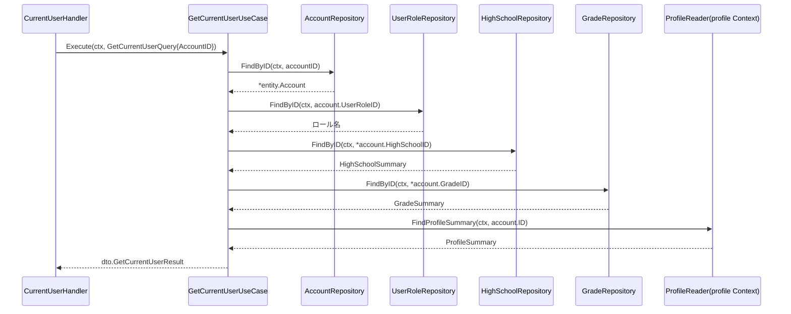

# 認証機能 Go実装仕様書（2. セッション）

---

# 1. 本書の範囲

## 担当するエンドポイント

|Method|Path|Handler|概要|
|-|-|-|-|
|POST|`/api/v1/login`|`SessionHandler.Login`|メールアドレスとパスワードで認証し、JWTをHTTP Only Cookieで発行する|
|DELETE|`/api/v1/logout`|`SessionHandler.Logout`|`jti`を更新してセッションを無効化し、Cookieを削除する|
|GET|`/api/v1/me`|`CurrentUserHandler.Show`|ログイン中ユーザー自身の基礎情報を返す|

## 担当するファイル

```
internal/authentication/application/dto/get_current_user_dto.go
internal/authentication/application/dto/login_dto.go
internal/authentication/application/dto/logout_dto.go
internal/authentication/application/usecase/get_current_user_usecase.go
internal/authentication/application/usecase/login_usecase.go
internal/authentication/application/usecase/logout_usecase.go
internal/authentication/infrastructure/repository/profile_reader.go
internal/authentication/infrastructure/security/jwt_token_issuer.go
internal/authentication/presentation/handler/current_user_handler.go
internal/authentication/presentation/handler/session_handler.go
internal/authentication/presentation/request/session_request.go
```

実装11ファイル、テスト込みで約19。

## 本書が前提とする文書

- `認証機能_Go実装仕様書_1_基盤.md`: Domain（`Account` Entity・`Email`・`RawPassword`・`StudentNumber`・`AccountRepository`・`UserRoleRepository`・`CredentialVerificationService`・`PasswordHasher`・Domain Error）、共通Infrastructure（`AccountRepositoryImpl`・`UserRoleRepositoryImpl`・`BcryptPasswordHasher`・GORMモデル・`UserResponse`・`MessageResponse`・`routes.go`）、およびTransaction・Validation・Authorization・Error・GORMの実装方針
- 基盤編を実装・マージしたうえで本書の実装に着手する

本書では、基盤編に記載した実装方針を繰り返さない。

---

# 2. Application層設計

## DTO（Command / Query）

|struct名|フィールド|区分|
|-|-|-|
|`LoginQuery`|`Email string`, `Password string`|Query|
|`LoginResult`|`AccountID uint`, `Email string`, `UserRoleID uint`, `Token string`, `ExpiresAt time.Time`|出力|
|`LogoutCommand`|`AccountID uint`|Command|
|`LogoutResult`|`Message string`|出力|
|`GetCurrentUserQuery`|`AccountID uint`|Query|
|`GetCurrentUserResult`|`AccountID uint`, `Name string`, `NameKana string`, `Email string`, `ProfileCompleted bool`, `UserRoleName string`, `HighSchool *dto.HighSchoolInfo`, `Grade *dto.GradeInfo`, `PersonalInfo *dto.PersonalInfoView`, `Address *dto.AddressView`|出力|

`HighSchoolInfo{ID uint, Name string}`, `GradeInfo{ID uint, Year int, DisplayName string}`, `PersonalInfoView`/`AddressView`はprofile Context側の参照結果をそのまま転記する構造（フィールド詳細はprofile Contextの③文書に委ねる）。

## UseCase

### LoginUseCase（`application/usecase/login_usecase.go`）

- struct名: `LoginUseCase`
- コンストラクタが受け取る依存: `AccountRepository`（Interface）, `*service.CredentialVerificationService`, `TokenIssuer`（本ファイル内で定義するInterface）
- 公開メソッド: `(u *LoginUseCase) Execute(ctx context.Context, query dto.LoginQuery) (dto.LoginResult, error)`
- 処理ステップ:
  1. `valueobject.NewEmail` / `NewRawPassword`で入力を検証する
  2. `AccountRepository.FindByEmail`で対象アカウントを取得する（存在しない場合も次のステップで同一エラーに集約する）
  3. `CredentialVerificationService.Verify`で照合する
  4. `TokenIssuer.Issue`でJWTを発行する
  5. `LoginResult`を組み立てて返す
- トランザクション境界: なし（②「14. Transaction設計」により読み取りのみ）
- 発生しうるApplication Error: `ErrInvalidCredentials`（アカウント不存在・パスワード不一致のいずれも同一エラーとして扱い、ユーザー列挙を防ぐ）

> **②からの補足**: `TokenIssuer`はJWT発行という技術的関心事のためのInterfaceであり、利用側（`LoginUseCase`）で定義する（コーディング規約「7. インターフェース」準拠）。メソッドシグネチャ: `Issue(ctx context.Context, accountID uint, jti string, userRoleID uint) (token string, expiresAt time.Time, err error)`。実装は`infrastructure/security/jwt_token_issuer.go`に置く。②「11. Repository設計」により、`FindByEmail`は退会済みアカウントも検索対象に含める（ログイン時の除外要否は②に明記がなく、本機能では退会済み除外はパスワードリセット対象検索に限定する方針。9章のGORM設計を参照）。

### LogoutUseCase（`application/usecase/logout_usecase.go`）

- struct名: `LogoutUseCase`
- コンストラクタが受け取る依存: `AccountRepository`, `JTIGenerator`（Interface、後述）, `TransactionManager`（アーキテクチャ規約「11. Transaction実装パターン」）
- 公開メソッド: `(u *LogoutUseCase) Execute(ctx context.Context, cmd dto.LogoutCommand) (dto.LogoutResult, error)`
- 処理ステップ:
  1. `JTIGenerator.Generate`で新しい`jti`を生成する
  2. `TransactionManager.WithinTransaction`内で`AccountRepository.UpdateJTI`を実行する
  3. `LogoutResult`を返す
- トランザクション境界: `UpdateJTI`実行を1トランザクションとする（②「14. Transaction設計」）
- 発生しうるApplication Error: Infrastructure Error（DB更新失敗）

### GetCurrentUserUseCase（`application/usecase/get_current_user_usecase.go`）

- struct名: `GetCurrentUserUseCase`
- コンストラクタが受け取る依存: `AccountRepository`, `UserRoleRepository`, `HighSchoolRepository`, `GradeRepository`, `ProfileReader`（Interface、後述）
- 公開メソッド: `(u *GetCurrentUserUseCase) Execute(ctx context.Context, query dto.GetCurrentUserQuery) (dto.GetCurrentUserResult, error)`
- 処理ステップ（②「13. シーケンス図」の`GetCurrentUserUseCase`シーケンス図に対応）:
  1. `AccountRepository.FindByID(ctx, query.AccountID)`でアカウント基礎情報を取得する
  2. `UserRoleRepository.FindByID(ctx, account.UserRoleID)`でロール名を取得する
  3. `account.HighSchoolID` / `account.GradeID`が設定されている場合のみ`HighSchoolRepository.FindByID` / `GradeRepository.FindByID`を呼び出す
  4. `ProfileReader.FindProfileSummary(ctx, account.ID)`で氏名・氏名カナ・個人情報・住所・`profile_completed`を取得する（profile Contextが公開する参照手段、アーキテクチャ規約「5. Context間連携ルール」）
  5. 取得結果を合成し`GetCurrentUserResult`を返す
- トランザクション境界: なし（読み取りのみ）
- 発生しうるApplication Error: なし（本人確認済みセッションからのみ呼び出される前提。対象アカウント不存在はInfrastructure Errorとして扱う）

> **②からの補足**: `ProfileReader`は②「6. Entity設計」「11. Repository設計」が「profile Contextが所有・更新するデータを参照専用で組み込む」「profile Context参照（Repositoryとしては持たない）」としていることを踏まえ、application層で定義する利用側インターフェースとした（コーディング規約「7. インターフェース」準拠）。メソッドシグネチャ: `FindProfileSummary(ctx context.Context, userID uint) (ProfileSummary, error)`。`ProfileSummary`のフィールド: `Name string`, `NameKana string`, `PhoneNumber *string`, `Birthday *time.Time`, `Gender *string`, `Address *AddressView`, `ProfileCompleted bool`。実装（`infrastructure/repository/profile_reader.go`）はprofile Context側が公開するStoreの参照メソッドを呼び出すアダプタとする（詳細は8章）。旧版が「概念のみに留め確定させない」としていた`UserProfileReader`を、profile Context側の②③文書が整備されたことを受けて本書で具体化したものである（②からの補足、profile Context側の③文書と合わせて実装する）。

---

---

# 3. Infrastructure層設計（本書の担当）

## Repository実装（本書の担当）

### ProfileReaderImpl（`infrastructure/repository/profile_reader.go`）

- 実装struct名: 非公開struct（例: `profileReader`）+ コンストラクタ`NewProfileReader(...) usecase.ProfileReader`
- 責務: profile Context（プロフィール管理機能、Active Record採用）が公開する`ProfileAccountStore` / `PersonalInfoStore`相当の参照メソッドを呼び出し、`ProfileSummary`へ変換する
- 判断根拠: アーキテクチャ規約「5. Context間連携ルール」により、他Contextの内部実装（GORMモデル等）に直接依存せず、相手Contextが公開する参照手段のみを利用する

> **②からの補足**: profile Context側は本タスクで新規作成する`プロフィール管理機能_Go実装仕様書.md`でActive Recordの構造（`model.go`・`store.go`）として定義される。本Contextの`ProfileReaderImpl`は、profile Context側が公開するコンストラクタ（例: `profile.NewContext(db, logger)`が返す参照用関数、または個別にexportされたStoreの参照メソッド）を呼び出す想定だが、具体的な公開シグネチャはプロジェクト全体のDI配線（アーキテクチャ規約「14. 依存関係の組み立て」）確定後にprofile Context側と合わせて確定する（推測）。

## 認証技術アダプタ（本書の担当）

|実装対象|呼び出し元|実装方針|
|-|-|-|
|`JWTTokenIssuer`（`infrastructure/security/jwt_token_issuer.go`）|`LoginUseCase`|`application/usecase.TokenIssuer`インターフェースを実装する。JWTのクレーム（`sub`, `jti`, `role`等）・署名鍵管理は②「19. API仕様」のCookie仕様と整合させる|

`LogoutUseCase`が使う`JTIGenerator`は`SecureTokenGenerator`（`infrastructure/security/secure_token_generator.go`）の実装であり、パスワードリセット編で定義する。本書の実装時点で未作成の場合は、パスワードリセット編より先に本書を実装するため、`SecureTokenGenerator`を本書で作成してよい（どちらの編が先に実装されても重複しないよう、ファイルの担当はパスワードリセット編に置く）。

---

# 4. Presentation層設計

## Handler

### SessionHandler（`presentation/handler/session_handler.go`）

- struct名: `SessionHandler`
- 対応する呼び出し先: `*usecase.LoginUseCase`, `*usecase.LogoutUseCase`
- メソッド一覧:

|メソッド|HTTPメソッド|パス|
|-|-|-|
|`Login`|POST|`/api/v1/user/login`|
|`Logout`|DELETE|`/api/v1/user/logout`|

- `Login`処理順序: リクエストバインド（`request.LoginRequest`）→ Presentation Validation（`binding`タグによる型・必須・メール形式チェック）→ `LoginUseCase.Execute`呼び出し → 成功時、Cookie（`access_token`）を`httponly`/`secure`/`same_site: lax`/`path: /`/有効期限1日で設定 → `response.UserResponse`へ変換して返却
- `Logout`処理順序: Middlewareで設定済みの`current_user`（AccountID）を取得 → `LogoutUseCase.Execute`呼び出し → Cookie（`access_token`）削除 → `response.MessageResponse`を返却

### CurrentUserHandler（`presentation/handler/current_user_handler.go`）

- struct名: `CurrentUserHandler`
- 対応する呼び出し先: `*usecase.GetCurrentUserUseCase`
- メソッド一覧:

|メソッド|HTTPメソッド|パス|
|-|-|-|
|`GetCurrentUser`|GET|`/api/v1/me`|

- 処理順序: Middlewareで設定済みの`current_user`（AccountID）を取得（未設定時はMiddleware側で401、②「16. Authorization設計」）→ `dto.GetCurrentUserQuery{AccountID: ...}`を組み立て`GetCurrentUserUseCase.Execute`呼び出し → `response.UserResponse`へ変換して返却（Status 200）

## Request DTO

|struct名|フィールドと型|バリデーションタグ／チェック内容|
|-|-|-|
|`LoginRequest`|`Email string`, `Password string`|`binding:"required,email"` / `binding:"required"`|

`GetCurrentUser`（`GET /api/v1/me`）はパラメータを持たないためRequest DTOを設けない。

Response DTO（`UserResponse`・`MessageResponse`）は基盤編「6. Infrastructure層設計（共通）」の「共通のResponse DTO」に従う。

---

# 5. シーケンス図・処理フロー図

## シーケンス図（GetCurrentUserUseCase）



---

# 6. API仕様

## Errorケース

|Endpoint|条件|Status Code|Error内容|
|-|-|-|-|
|`GET /api/v1/me`|`current_user`未設定（未認証）|401|Middlewareレベルで拒否（②「17. Error設計」エラー仕様表）|

---

---

# 7. テストケース設計（本書の担当分）

Domain Test・Repository Testのうち基盤編が担当する分は基盤編に記載する。本書は本スライスのUseCase・Handlerのテストを扱う。
