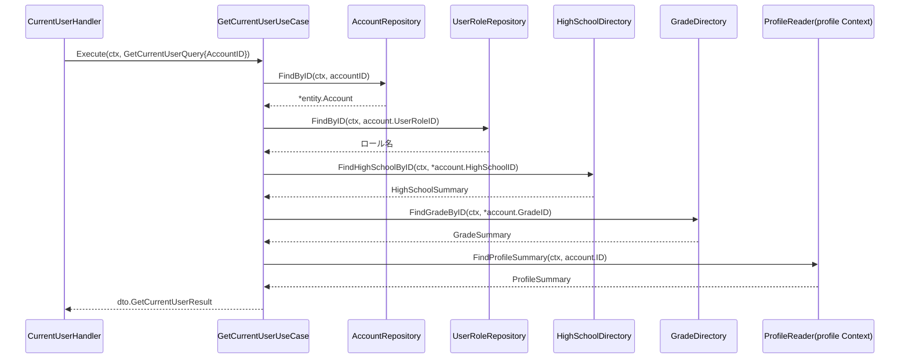

# 認証機能 Go実装仕様書（2. セッション）

---

# 1. 機能概要

## 本書が担当するエンドポイント

|Method|Path|Handler|概要|
|-|-|-|-|
|POST|`/api/v1/login`|`SessionHandler.Login`|メールアドレスとパスワードで認証し、JWTをHTTP Only Cookieで発行する|
|DELETE|`/api/v1/logout`|`SessionHandler.Logout`|`jti`を更新してセッションを無効化し、Cookieを削除する|
|GET|`/api/v1/me`|`CurrentUserHandler.GetCurrentUser`|ログイン中ユーザー自身の基礎情報を返す|

## 本書の位置づけ

本書は`認証機能_Go実装仕様書_1_基盤.md`（以下「基盤編」）のスライス編である。

基盤編が定めるもの（本書では繰り返さない）:

- Domain層のすべて（`Account` Entity・`Email`・`RawPassword`・`StudentNumber`・`AccountRepository`・`UserRoleRepository`・`CredentialVerificationService`・`PasswordHasher`・Domain Error）
- `dependency.go`（`ProfileReader`・`HighSchoolDirectory`・`GradeDirectory`の3インターフェース。本書は`ProfileReader`の実装のみ担当する）
- 共通Infrastructure（`AccountRepository`・`UserRoleRepository`実装・`BcryptPasswordHasher`・GORMモデル）
- 共通Presentation（`UserResponse`・`MessageResponse`・`routes.go`）
- `context.go`、およびTransaction・Validation・Authorization・Error・GORMの実装方針

本書が定めるもの:

- 上記3エンドポイントのApplication層（UseCase・DTO）
- `ProfileReader`の実装（`infrastructure/contextadapter/profile_reader.go`）
- 同Presentation層（Handler・Request DTO）
- 同API仕様・テストケース設計

## 採用設計パターン

Domain Model（②「4. 設計パターン」）。基盤編「1. 機能概要」を参照。

基盤編を実装・マージしたうえで本書の実装に着手する。

---

# 2. ディレクトリ構成

基盤編「2. ディレクトリ構成」の機能全体のファイル一覧のうち、本書が担当するものは以下の8である。

```
internal/authentication/application/usecase/get_current_user_usecase.go
internal/authentication/application/usecase/login_usecase.go
internal/authentication/application/usecase/logout_usecase.go
internal/authentication/infrastructure/contextadapter/profile_reader.go
internal/authentication/infrastructure/security/jwt_token_issuer.go
internal/authentication/presentation/handler/current_user_handler.go
internal/authentication/presentation/handler/session_handler.go
internal/authentication/presentation/request/session_request.go
```

テストが付くのはUseCase3つとHandler2つ（セッション用・現在ユーザー用）、`ProfileReader`実装の6であり、テスト込みで約19となる。

`presentation/response/`配下に本書専用のファイルを作成しない。いずれのエンドポイントも基盤編の`UserResponse` / `MessageResponse`をそのまま返すためである（②「19. API仕様」）。

`presentation/routes.go`は基盤編が担当する。

---

# 3. Domain層設計

本書では定義しない。基盤編「3. Domain層設計」を参照。

本書のUseCaseが使うDomain層の要素: `entity.Account`、`domain/errors.ErrInvalidCredentials`、`domain/service.CredentialVerificationService`。

本書だけが使うDomain層の要素はない。

---

# 4. クラス図

基盤編「4. クラス図」を参照。本書はUseCase・Handler・`ProfileReader`実装を追加するのみである。

---

# 5. 状態遷移図

基盤編「5. 状態遷移図」を参照。本書のUseCaseは状態遷移を発生させない（`LogoutUseCase`は`jti`をローテーションするのみで、Accountの招待状態・仮登録状態のいずれも変更しない）。

---

# 6. Application層設計

## DTO（Command / Query）

|struct名|フィールド|区分|
|-|-|-|
|`LoginQuery`|`Email string`, `Password string`|Query|
|`LoginResult`|`AccountID uint`, `Email string`, `UserRoleID uint`, `Token string`, `ExpiresAt time.Time`|出力|
|`LogoutCommand`|`AccountID uint`|Command|
|`LogoutResult`|`Message string`|出力|
|`GetCurrentUserQuery`|`AccountID uint`|Query|
|`GetCurrentUserResult`|`AccountID uint`, `Name string`, `NameKana string`, `Email string`, `ProfileCompleted bool`, `UserRoleName string`, `HighSchool *dependency.HighSchoolSummary`, `Grade *dependency.GradeSummary`, `PersonalInfo *dependency.ProfileSummary`|出力|

`HighSchoolSummary`・`GradeSummary`・`ProfileSummary`は`dependency.go`（基盤編）で定義した型をそのまま使う。

## UseCase

### LoginUseCase（`application/usecase/login_usecase.go`）

- struct名: `LoginUseCase`
- コンストラクタが受け取る依存: `AccountRepository`（Interface）, `*service.CredentialVerificationService`, `TokenIssuer`（本ファイル内で定義するInterface）
- 公開メソッド: `(u *LoginUseCase) Execute(ctx context.Context, query dto.LoginQuery) (dto.LoginResult, error)`
- 処理ステップ:
  1. `valueobject.NewEmail` / `NewRawPassword`で入力を検証する
  2. `AccountRepository.FindByEmail`で対象アカウントを取得する（存在しない場合も次のステップで同一エラーに集約する）
  3. `CredentialVerificationService.Verify`で照合する
  4. `TokenIssuer.Issue`でJWTを発行する
  5. `LoginResult`を組み立てて返す
- トランザクション境界: なし（②「14. Transaction設計」により読み取りのみ）
- 発生しうるApplication Error: `ErrInvalidCredentials`（アカウント不存在・パスワード不一致のいずれも同一エラーとして扱い、ユーザー列挙を防ぐ）

> **②からの補足**: `TokenIssuer`はJWT発行という技術的関心事のためのInterfaceであり、利用側（`LoginUseCase`）で定義する（コーディング規約「7. インターフェース」準拠。他Contextへの依存ではないため`dependency.go`には置かない）。メソッドシグネチャ: `Issue(ctx context.Context, accountID uint, jti string, userRoleID uint) (token string, expiresAt time.Time, err error)`。実装は`infrastructure/security/jwt_token_issuer.go`に置く。②「11. Repository設計」により、`FindByEmail`は退会済みアカウントも検索対象に含める（ログイン時の除外要否は②に明記がなく、本機能では退会済み除外はパスワードリセット対象検索に限定する方針。基盤編「15. GORM / DBクエリ設計」を参照）。

### LogoutUseCase（`application/usecase/logout_usecase.go`）

- struct名: `LogoutUseCase`
- コンストラクタが受け取る依存: `AccountRepository`, `JTIGenerator`（Interface、パスワードリセット編の`SecureTokenGenerator`参照）, `transaction.Manager`（アーキテクチャ規約「11. Transaction実装パターン」）
- 公開メソッド: `(u *LogoutUseCase) Execute(ctx context.Context, cmd dto.LogoutCommand) (dto.LogoutResult, error)`
- 処理ステップ:
  1. `JTIGenerator.Generate`で新しい`jti`を生成する
  2. `transaction.Manager.WithinTransaction`内で`AccountRepository.UpdateJTI`を実行する
  3. `LogoutResult`を返す
- トランザクション境界: `UpdateJTI`実行を1トランザクションとする（②「14. Transaction設計」）
- 発生しうるApplication Error: Infrastructure Error（DB更新失敗）

### GetCurrentUserUseCase（`application/usecase/get_current_user_usecase.go`）

- struct名: `GetCurrentUserUseCase`
- コンストラクタが受け取る依存: `AccountRepository`, `UserRoleRepository`, `dependency.HighSchoolDirectory`, `dependency.GradeDirectory`, `dependency.ProfileReader`
- 公開メソッド: `(u *GetCurrentUserUseCase) Execute(ctx context.Context, query dto.GetCurrentUserQuery) (dto.GetCurrentUserResult, error)`
- 処理ステップ（②「13. シーケンス図」の`GetCurrentUserUseCase`シーケンス図に対応）:
  1. `AccountRepository.FindByID(ctx, query.AccountID)`でアカウント基礎情報を取得する
  2. `UserRoleRepository.FindByID(ctx, account.UserRoleID)`でロール名を取得する
  3. `account.HighSchoolID` / `account.GradeID`が設定されている場合のみ`HighSchoolDirectory.FindHighSchoolByID` / `GradeDirectory.FindGradeByID`を呼び出す
  4. `ProfileReader.FindProfileSummary(ctx, account.ID)`で氏名・氏名カナ・個人情報・住所・`profile_completed`を取得する（`profile` Contextが公開する参照手段、アーキテクチャ規約「5. Context間連携ルール」）
  5. 取得結果を合成し`GetCurrentUserResult`を返す
- トランザクション境界: なし（読み取りのみ）
- 発生しうるApplication Error: なし（本人確認済みセッションからのみ呼び出される前提。対象アカウント不存在はInfrastructure Errorとして扱う）

---

# 7. シーケンス図・処理フロー図

## シーケンス図（GetCurrentUserUseCase）



## 処理フロー図

省略する。理由: ログイン・ログアウト・現在ユーザー取得のいずれも条件分岐がほとんどない単純な手続きである。

---

# 8. Infrastructure層設計

## contextadapter（`dependency.go`のインターフェースの実装。本書の担当）

### ProfileReader実装（`infrastructure/contextadapter/profile_reader.go`）

- 実装struct名: 非公開struct（例: `profileReader`）+ コンストラクタ`NewProfileReader(profileContext *profile.Context) authentication.ProfileReader`
- 責務: `profile` Context（プロフィール管理機能、Active Record採用）が公開する参照メソッドを呼び出し、`dependency.ProfileSummary`へ変換する
- 判断根拠: アーキテクチャ規約「5. Context間連携ルール」により、他Contextの内部実装（GORMモデル等）に直接依存せず、相手Contextが公開する参照手段のみを利用する
- 本アダプタはGORMに依存せず、`users`・`user_personal_infos`・`addresses`へクエリを発行しない

> **②からの補足**: `profile` Context側は`プロフィール管理機能_Go実装仕様書.md`でActive Recordの構造（`model.go`・`store.go`）として定義される。本Contextの`ProfileReader`実装は、`profile`側の`NewContext`が返す参照用の値を呼び出す。具体的な公開シグネチャはプロフィール管理機能③の確定内容に合わせる（推測。プロフィール管理機能③は現時点で本Contextへの公開操作を持たないため、`profile`側の追随時に`FindProfileSummary`相当の参照手段を追加する必要がある。**要確認**）。

## 認証技術アダプタ（本書の担当）

|実装対象|呼び出し元|実装方針|
|-|-|-|
|`JWTTokenIssuer`（`infrastructure/security/jwt_token_issuer.go`）|`LoginUseCase`|`application/usecase.TokenIssuer`インターフェースを実装する。JWTのクレーム（`sub`, `jti`, `role`等）・署名鍵管理は②「19. API仕様」のCookie仕様と整合させる|

`LogoutUseCase`が使う`JTIGenerator`は`SecureTokenGenerator`（`infrastructure/security/secure_token_generator.go`）の実装であり、パスワードリセット編で定義する。本書の実装時点で未作成の場合は、パスワードリセット編より先に本書を実装するため、`SecureTokenGenerator`を本書で作成してよい（どちらの編が先に実装されても重複しないよう、ファイルの担当はパスワードリセット編に置く）。

---

# 9. Presentation層設計

## Handler

### SessionHandler（`presentation/handler/session_handler.go`）

- struct名: `SessionHandler`
- 対応する呼び出し先: `*usecase.LoginUseCase`, `*usecase.LogoutUseCase`
- メソッド一覧:

|メソッド|HTTPメソッド|パス|
|-|-|-|
|`Login`|POST|`/api/v1/user/login`|
|`Logout`|DELETE|`/api/v1/user/logout`|

- `Login`処理順序: リクエストバインド（`request.LoginRequest`）→ Presentation Validation（`binding`タグによる型・必須・メール形式チェック）→ `LoginUseCase.Execute`呼び出し → 成功時、Cookie（`access_token`）を`httponly`/`secure`/`same_site: lax`/`path: /`/有効期限1日で設定 → `response.UserResponse`へ変換して返却
- `Logout`処理順序: Middlewareで設定済みの`current_user`（AccountID）を取得 → `LogoutUseCase.Execute`呼び出し → Cookie（`access_token`）削除 → `response.MessageResponse`を返却

### CurrentUserHandler（`presentation/handler/current_user_handler.go`）

- struct名: `CurrentUserHandler`
- 対応する呼び出し先: `*usecase.GetCurrentUserUseCase`
- メソッド一覧:

|メソッド|HTTPメソッド|パス|
|-|-|-|
|`GetCurrentUser`|GET|`/api/v1/me`|

- 処理順序: Middlewareで設定済みの`current_user`（AccountID）を取得（未設定時はMiddleware側で401、基盤編「13. Authorization実装方針」）→ `dto.GetCurrentUserQuery{AccountID: ...}`を組み立て`GetCurrentUserUseCase.Execute`呼び出し → `response.UserResponse`へ変換して返却（Status 200）

## Request / Response DTO

### Request（`presentation/request/session_request.go`）

|struct名|フィールドと型|バリデーションタグ／チェック内容|
|-|-|-|
|`LoginRequest`|`Email string`, `Password string`|`binding:"required,email"` / `binding:"required"`|

`GetCurrentUser`（`GET /api/v1/me`）はパラメータを持たないためRequest DTOを設けない。

Response DTO（`UserResponse`・`MessageResponse`）は基盤編「9. Presentation層設計」の「Response DTO（共通）」に従う。本書専用のResponse DTOは作成しない。

## Routing

基盤編「9. Presentation層設計」の`routes.go`に、本書のHandlerに対応する3ルート（`POST /api/v1/user/login`・`DELETE /api/v1/user/logout`・`GET /api/v1/me`）が含まれる。本書では追加しない。

---

# 10. API仕様

|Method|Path|Handler|Request|Response|Status Code|
|-|-|-|-|-|-|
|POST|/api/v1/user/login|`SessionHandler.Login`|`LoginRequest`|`UserResponse`|200|
|DELETE|/api/v1/user/logout|`SessionHandler.Logout`|なし|`MessageResponse`|200|
|GET|/api/v1/me|`CurrentUserHandler.GetCurrentUser`|なし|`UserResponse`|200|

## Errorケース

|Endpoint|条件|Status Code|Error内容|
|-|-|-|-|
|`POST /api/v1/user/login`|メールアドレス・パスワード不一致|401|`ErrInvalidCredentials`|
|`GET /api/v1/me`・`DELETE /api/v1/user/logout`|`current_user`未設定（未認証）|401|Middlewareレベルで拒否（基盤編「14. Error実装方針」エラー仕様表）|

---

# 11. Transaction実装方針

基盤編「11. Transaction実装方針」を参照。本書のUseCaseのうち、`LogoutUseCase`のみ`transaction.Manager.WithinTransaction`を使用する（`UpdateJTI`の1操作）。`LoginUseCase`・`GetCurrentUserUseCase`は読み取りのみのためトランザクションを使用しない。

---

# 12. Validation実装方針

基盤編「12. Validation実装方針」の`LoginRequest`の行を参照。本書に固有の業務ルール検証はない。

---

# 13. Authorization実装方針

基盤編「13. Authorization実装方針」を参照。本書固有の追加はない。

---

# 14. Error実装方針

基盤編「14. Error実装方針」のエラー対応表を参照。本書固有の追加はない（上記「10. API仕様」のErrorケースは基盤編の表の抜粋である）。

---

# 15. GORM / DBクエリ設計

基盤編「15. GORM / DBクエリ設計」を参照。本書固有のGORMモデル・クエリはない。`ProfileReader`実装はGORMに依存しない（「8. Infrastructure層設計」）。

---

# 16. テストケース設計（本書の担当分）

Domain Test・Repository Testは基盤編が担当する。本書は本スライスのUseCase・Handler・`ProfileReader`実装のテストを扱う。

## UseCase Test

|対象|テストケース|
|-|-|
|`LoginUseCase`|正しい資格情報で`LoginResult`（トークンを含む）が返ること／メールアドレス不存在・パスワード不一致のいずれも`ErrInvalidCredentials`になること（列挙防止）|
|`LogoutUseCase`|実行後に`jti`が更新されること|
|`GetCurrentUserUseCase`|所属高校・学年が設定されている場合に`HighSchoolDirectory`・`GradeDirectory`が呼ばれること／未設定の場合に呼ばれないこと／`ProfileReader`の結果が`GetCurrentUserResult`に正しく合成されること|

## contextadapter Test

|対象|テストケース|
|-|-|
|`ProfileReader`|`profile`側への呼び出しパラメータが正しいこと／戻り値が`ProfileSummary`へ正しく変換されること|

## Handler Test

|対象|テストケース|
|-|-|
|`SessionHandler.Login`|正常系で200とCookie設定／不正な資格情報で401|
|`SessionHandler.Logout`|未認証で401／認証済みで200とCookie削除|
|`CurrentUserHandler.GetCurrentUser`|未認証で401／認証済みで200と`UserResponse`|

## Integration Test

|対象|テストケース|
|-|-|
|`POST /api/v1/user/login` → `GET /api/v1/me` → `DELETE /api/v1/user/logout`|一連の流れで正しく認証・参照・ログアウトができること|

---

# 17. ②からの補足事項

②に明記がなく、実装のために本書で補った内容である。基盤編「17. ②からの補足事項」に記載した内容に加え、本書固有のものを以下に示す。

|判断した内容|判断理由|推測か|
|-|-|-|
|`ProfileReader`実装を`infrastructure/contextadapter/`に置いた|アーキテクチャ規約「4. Bounded Context構成」が他Context依存のインターフェースの実装を`contextadapter/`に置くと定めているため（旧版は`infrastructure/repository/profile_reader.go`としていた）|推測ではない（規約に従った）|
|`profile`側に本Contextが必要とする参照操作（`FindProfileSummary`相当）がまだ公開されていない|プロフィール管理機能③は現時点で`authentication`向けの公開操作を持たない。`profile`側の追随時に追加が必要である|**要確認**（未着手）|
|`TokenIssuer`を`dependency.go`に置かず、`LoginUseCase`の利用側で定義した|`TokenIssuer`は他Contextへの依存ではなく、JWT発行という本Context内の技術的関心事であるため（コーディング規約「7. インターフェース」）|推測ではない|

上記以外の設計判断は基盤編の記載をそのまま踏襲する。
