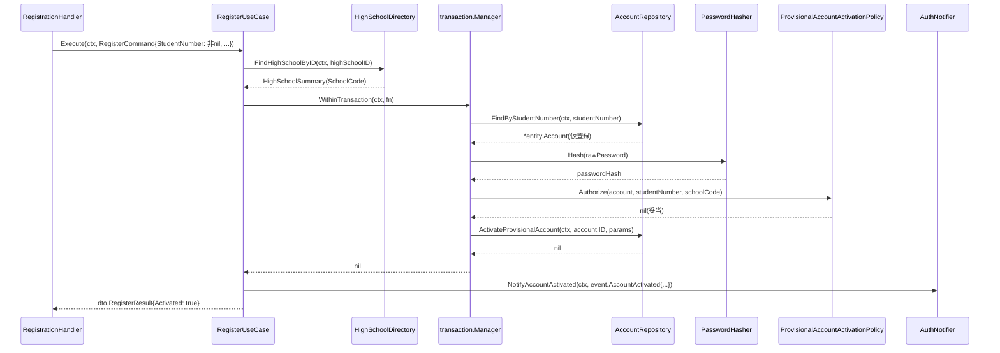

# 認証機能 Go実装仕様書（3. 登録）

---

# 1. 機能概要

## 本書が担当するエンドポイント

|Method|Path|Handler|概要|
|-|-|-|-|
|POST|`/api/v1/student/signup`|`RegistrationHandler.SignUpStudent`|生徒の新規登録。生徒コードを指定した場合は、仮アカウントの有効化に分岐する|
|POST|`/api/v1/teacher/signup`|`RegistrationHandler.SignUpTeacher`|教員の新規登録|
|POST|`/api/v1/admin/signup`|`RegistrationHandler.SignUpAdmin`|管理者の新規登録|

## 本書の位置づけ

本書は`認証機能_Go実装仕様書_1_基盤.md`（以下「基盤編」）のスライス編である。

基盤編が定めるもの（本書では繰り返さない）:

- Domain層のうち複数のスライスが使うもの（`Account` Entity・`Email`・`RawPassword`・`StudentNumber`・`AccountRepository`・`UserRoleRepository`・`CredentialVerificationService`・`PasswordHasher`・Domain Error）
- `dependency.go`（`ProfileReader`・`HighSchoolDirectory`・`GradeDirectory`の3インターフェース。本書は`HighSchoolDirectory`・`GradeDirectory`の実装のみ担当する）
- 共通Infrastructure（`AccountRepository`・`UserRoleRepository`実装・`BcryptPasswordHasher`・GORMモデル）
- 共通Presentation（`UserResponse`・`MessageResponse`・`routes.go`）
- `context.go`、およびTransaction・Validation・Authorization・Error・GORMの実装方針

本書が定めるもの:

- 本スライス固有のDomain（`SignUpRoleRequirement`・`RegistrationEligibilityPolicy`・`ProvisionalAccountActivationPolicy`・`AccountActivated`イベント）
- 上記3エンドポイントのApplication層（`RegisterUseCase`・DTO）
- `HighSchoolDirectory`・`GradeDirectory`の実装（`infrastructure/contextadapter/`）
- 同Presentation層（Handler・Request DTO）
- 同API仕様・テストケース設計

## 採用設計パターン

Domain Model（②「4. 設計パターン」）。基盤編「1. 機能概要」を参照。

基盤編を実装・マージしたうえで本書の実装に着手する。

---

# 2. ディレクトリ構成

基盤編「2. ディレクトリ構成」の機能全体のファイル一覧のうち、本書が担当するものは以下の9である。

```
internal/authentication/domain/event/account_activated.go
internal/authentication/domain/service/provisional_account_activation_policy.go
internal/authentication/domain/service/registration_eligibility_policy.go
internal/authentication/domain/valueobject/signup_role_requirement.go
internal/authentication/application/usecase/register_usecase.go
internal/authentication/infrastructure/contextadapter/high_school_directory.go
internal/authentication/infrastructure/contextadapter/grade_directory.go
internal/authentication/presentation/handler/registration_handler.go
internal/authentication/presentation/request/registration_request.go
```

テストが付くのは`SignUpRoleRequirement`・`RegistrationEligibilityPolicy`・`ProvisionalAccountActivationPolicy`・`RegisterUseCase`・2つのアダプタ・`RegistrationHandler`の7であり、テスト込みで約16となる。

`presentation/response/`配下に本書専用のファイルを作成しない。登録成功時も基盤編の`UserResponse`をそのまま返すためである（②「19. API仕様」）。

---

# 3. Domain層設計

基盤編「3. Domain層設計」に記載したDomainは繰り返さない。本書は本スライスだけが使うDomainを扱う。

## Value Object

### SignUpRoleRequirement（`domain/valueobject/signup_role_requirement.go`）

- struct名: `SignUpRoleRequirement`
- フィールド: `roleName string`（非公開）
- 生成時に検証するルール: ロール名（`student`/`teacher`/`admin`）に応じて高校ID・学年ID・生徒コードが必須かを判定するルールを保持する
- 公開メソッド:
  - `NewSignUpRoleRequirement(roleName string) SignUpRoleRequirement`
  - `(r SignUpRoleRequirement) RequiresHighSchool() bool`
  - `(r SignUpRoleRequirement) RequiresGrade(highSchoolIsCSVManaged bool) bool`
  - `(r SignUpRoleRequirement) RequiresStudentNumber(highSchoolIsCSVManaged bool) bool`

> **②からの補足**: ②「7. Value Object設計」は「studentかつ選択した高校が生徒コード管理対象校（`csv_managed`）の場合、`grade_id`の代わりに`student_number`の入力を必須とする分岐を含む」としている。この判定はロール名だけでなく選択高校の`csv_managed`区分（`HighSchoolDirectory`経由で取得する動的な値）にも依存するため、`RequiresGrade` / `RequiresStudentNumber`は`highSchoolIsCSVManaged bool`を引数に取る形とした。②はメソッドシグネチャそのものを規定していないため、引数設計は実装判断である（推測）。

他Contextの参照手段（`HighSchoolDirectory`・`GradeDirectory`）は基盤編「2. ディレクトリ構成」の`dependency.go`に定義済みである。本書では繰り返さない。

## Domain Service

### RegistrationEligibilityPolicy（`domain/service/registration_eligibility_policy.go`）

- struct名: `RegistrationEligibilityPolicy`
- メソッドシグネチャ: `(p RegistrationEligibilityPolicy) Validate(requirement valueobject.SignUpRoleRequirement, highSchoolID, gradeID *uint, studentNumber *valueobject.StudentNumber, highSchoolExists bool, gradeExists bool, highSchoolIsCSVManaged bool) error`
- 責務: 通常登録（生徒コード未指定）時、ロール別要件（学生・教員は高校・学年必須、管理者は不要。生徒コード管理対象校のstudentは`grade_id`の代わりに`student_number`が必須）を満たしているかを判定する

### ProvisionalAccountActivationPolicy（`domain/service/provisional_account_activation_policy.go`）

- struct名: `ProvisionalAccountActivationPolicy`
- 依存: なし
- メソッドシグネチャ: `(p ProvisionalAccountActivationPolicy) Authorize(account *entity.Account, studentNumber valueobject.StudentNumber, highSchoolSchoolCode string) error`
- 責務: 生徒コードに一致する仮アカウントが有効化対象として妥当かを判定する（②「8. Domain Service」）
  - `account`が`nil`（該当する仮アカウントが存在しない）の場合、`ErrProvisionalAccountNotFound`を返す
  - `account.IsProvisional()`が`false`（既に有効化済み）の場合、`ErrProvisionalAccountAlreadyActivated`を返す
  - `studentNumber.MatchesSchoolCode(highSchoolSchoolCode)`が`false`（学校コード不一致）の場合、`ErrStudentNumberSchoolMismatch`を返す
  - 上記いずれにも該当しない場合のみ`nil`を返す

> **②からの補足**: ②「8. Domain Service」はメソッドシグネチャを規定していない。`account *entity.Account`を`nil`許容の引数としたのは、「該当する仮アカウントが見つからない」ケースをUseCase側での事前分岐ではなくPolicy内の判定として一元化するための実装判断である（推測）。

## Domain Event

### AccountActivated（`domain/event/account_activated.go`）

- イベントstruct名: `AccountActivated`
- 保持するフィールド: `AccountID uint`, `Email string`, `ActivatedAt time.Time`
- 発火元: `RegisterUseCase`（生徒コード指定による仮アカウントの有効化が完了した時点。②「18. Domain Event」）

> **②からの補足**: 本イベントの実際のディスパッチ機構は、アーキテクチャ規約「13. 非同期ジョブ実行パターン（JobQueue）」の「処理の分類」表に基づき、有効化完了メール送信は「ベストエフォートで良い処理」に分類されるため、`jobs`テーブルを経由せず、UseCaseがイベントを構築した後、Infrastructure層のアダプタ（`AuthNotifier`、パスワードリセット編が定義）がgoroutineを直接起動して送信する（規約13章「ベストエフォートで良い処理: goroutine起動」の例に準拠）。

---

# 4. クラス図

基盤編「4. クラス図」を参照。本書は`SignUpRoleRequirement`・`RegistrationEligibilityPolicy`・`ProvisionalAccountActivationPolicy`・`RegisterUseCase`・`HighSchoolDirectory`実装・`GradeDirectory`実装を追加するのみである。

---

# 5. 状態遷移図

基盤編「5. 状態遷移図」を参照。本書の`RegisterUseCase`は、「Account（仮登録・有効化状態）」の`Provisional --> Active`遷移（`Account.Activate`）を発生させる唯一のUseCaseである。通常登録パスは`NewAccount`による`Active`状態での新規作成であり、遷移は発生しない。

---

# 6. Application層設計

## DTO（Command / Query）

|struct名|フィールド|区分|
|-|-|-|
|`RegisterCommand`|`Email string`, `Password string`, `PasswordConfirmation string`, `Name string`, `NameKana string`, `RoleName string`, `HighSchoolID *uint`, `GradeID *uint`, `StudentNumber *string`|Command|
|`RegisterResult`|`AccountID uint`, `Email string`, `UserRoleID uint`, `HighSchoolID *uint`, `GradeID *uint`, `Activated bool`（仮アカウント有効化パスで`true`）|出力|

## UseCase

### RegisterUseCase（`application/usecase/register_usecase.go`）

- struct名: `RegisterUseCase`
- コンストラクタが受け取る依存: `UserRoleRepository`, `dependency.HighSchoolDirectory`, `dependency.GradeDirectory`, `AccountRepository`, `*service.RegistrationEligibilityPolicy`, `*service.ProvisionalAccountActivationPolicy`, `PasswordHasher`, `transaction.Manager`, `AuthNotifier`（Interface、パスワードリセット編）
- 公開メソッド: `(u *RegisterUseCase) Execute(ctx context.Context, cmd dto.RegisterCommand) (dto.RegisterResult, error)`
- 処理ステップ（②「13. シーケンス図・処理フロー図」のフローチャートに対応、分岐は`cmd.StudentNumber`の有無）:
  1. `valueobject.NewEmail` / `NewRawPassword`で入力形式を検証し、`RawPassword.Matches`でパスワード確認一致を検証する
  2. `UserRoleRepository.FindByName`でロールの存在確認・ID取得を行う（不正時は`ErrInvalidRole`）
  3. `cmd.StudentNumber`が指定されている場合（仮アカウント有効化パス）:
     1. `valueobject.NewStudentNumber(*cmd.StudentNumber)`で形式検証する
     2. `HighSchoolDirectory.FindHighSchoolByID(cmd.HighSchoolID)`で選択高校の`SchoolCode`を取得する
     3. `transaction.Manager.WithinTransaction`内で以下を実行する
        1. `AccountRepository.FindByStudentNumber`で仮アカウントを検索する
        2. `PasswordHasher.Hash`で新パスワードをハッシュ化する
        3. `ProvisionalAccountActivationPolicy.Authorize(account, studentNumber, highSchool.SchoolCode)`で有効化可否を判定する
        4. `account.Activate(now)`でドメイン状態を遷移させる
        5. `AccountRepository.ActivateProvisionalAccount(ctx, account.ID, params)`で永続化する
     4. `AuthNotifier.NotifyAccountActivated(ctx, event.AccountActivated{...})`を呼び出す（トランザクション確定後、ベストエフォート送信）
  4. `cmd.StudentNumber`が未指定の場合（通常登録パス）:
     1. `valueobject.NewSignUpRoleRequirement(cmd.RoleName)`でロール別要件を取得する
     2. 必要に応じて`HighSchoolDirectory.ExistsHighSchool` / `FindHighSchoolByID`（`csv_managed`判定用）・`GradeDirectory.ExistsGrade`を呼び出す
     3. `RegistrationEligibilityPolicy.Validate`で登録要件充足を判定する
     4. `PasswordHasher.Hash`でパスワードをハッシュ化する
     5. `transaction.Manager.WithinTransaction`内で`AccountRepository.Create`を実行する
  5. `RegisterResult`を返す
- トランザクション境界: 分岐ごとに「11. Transaction実装方針」で詳述
- 発生しうるApplication Error: `ErrInvalidRole`, `ErrRegistrationRequirementNotMet`, `ErrPasswordConfirmationMismatch`, `ErrProvisionalAccountNotFound`, `ErrProvisionalAccountAlreadyActivated`, `ErrStudentNumberSchoolMismatch`

---

# 7. シーケンス図・処理フロー図

## シーケンス図（RegisterUseCase、仮アカウント有効化パス）



## 処理フロー図（RegisterUseCase）

②「13. シーケンス図・処理フロー図」のフローチャートを、実際に定義したstruct/メソッド名で具体化する。

```mermaid
flowchart TD
    A[Execute呼び出し] --> B{UserRoleRepository.FindByNameでロールは実在するか}
    B -- No --> Z1[ErrInvalidRole]
    B -- Yes --> C{cmd.StudentNumberが指定されているか}
    C -- Yes --> D[valueobject.NewStudentNumberで形式検証]
    D --> E[HighSchoolDirectory.FindHighSchoolByIDでSchoolCode取得]
    E --> F[AccountRepository.FindByStudentNumberで仮アカウント検索]
    F --> G[ProvisionalAccountActivationPolicy.Authorize]
    G -- エラー --> Z2["ErrProvisionalAccountNotFound / ErrProvisionalAccountAlreadyActivated / ErrStudentNumberSchoolMismatch"]
    G -- nil --> H["account.Activate(now)"]
    H --> I[AccountRepository.ActivateProvisionalAccountで永続化]
    I --> J[AuthNotifier.NotifyAccountActivated]
    J --> K[RegisterResultを返す]
    C -- No --> L["valueobject.NewSignUpRoleRequirement(cmd.RoleName)"]
    L --> M{ロール要件(高校・学年 or 生徒コード必須)を満たすか}
    M -- No --> Z3[ErrRegistrationRequirementNotMet]
    M -- Yes --> N[AccountRepository.Createで新規作成]
    N --> K
```

---

# 8. Infrastructure層設計

## contextadapter（`dependency.go`のインターフェースの実装。本書の担当）

`high_schools` / `grades`テーブルは`master-data` Context（共通マスタ参照機能）が正規の所有者であるため、本Contextでは`HighSchoolModel` / `GradeModel`に相当するGORMモデルを独自定義せず、`HighSchoolDirectory` / `GradeDirectory`の実装は`master-data`が公開する操作を呼び出すラッパーとする（アーキテクチャ規約「5. Context間連携ルール」の「相手Contextが公開する参照手段を呼び出す」方針）。

### HighSchoolDirectory実装（`infrastructure/contextadapter/high_school_directory.go`）

- 実装struct名: 非公開struct（例: `highSchoolDirectory`）+ コンストラクタ`NewHighSchoolDirectory(masterDataContext *masterdata.Context) authentication.HighSchoolDirectory`
- `ExistsHighSchool(ctx, id)`: `master-data`の`FindHighSchools(ctx, []uint{id})`（共通マスタ参照機能③_1「公開する操作」）を呼び出し、結果が1件以上かで判定する
- `FindHighSchoolByID(ctx, id)`: 同じく`FindHighSchools(ctx, []uint{id})`を呼び出し、戻り値の`masterdata.HighSchoolRef`（`ID` / `Name` / `SchoolCode` / `CSVManaged`）を本Contextの`HighSchoolSummary`へ変換する。該当なしの場合は`found=false`を返す
- 本アダプタはGORMに依存せず、`high_schools`へクエリを発行しない

### GradeDirectory実装（`infrastructure/contextadapter/grade_directory.go`）

- 実装struct名: 非公開struct（例: `gradeDirectory`）+ コンストラクタ`NewGradeDirectory(masterDataContext *masterdata.Context) authentication.GradeDirectory`
- `ExistsGrade(ctx, id)`: `master-data`の`FindGrades(ctx, []uint{id})`を呼び出し、結果が1件以上かで判定する
- `FindGradeByID(ctx, id)`: 同じく`FindGrades(ctx, []uint{id})`を呼び出し、戻り値の`masterdata.GradeRef`（`ID` / `Year` / `DisplayName`）を本Contextの`GradeSummary`へ変換する。該当なしの場合は`found=false`を返す
- 本アダプタはGORMに依存せず、`grades`へクエリを発行しない

> **②からの補足**: `HighSchoolDirectory`・`GradeDirectory`の実装先は、共通マスタ参照機能③_1が公開する`FindHighSchools` / `FindGrades`とした。これらはauthentication Contextからの実在確認・詳細取得要求（②「3. Bounded Context」「他Contextとの依存関係」）を満たすために共通マスタ参照機能③_1側が既に公開している操作であり、②の設計判断を変更するものではなく、②が既に想定している依存を具体的な関数シグネチャへ落とし込んだものである（②からの補足）。

---

# 9. Presentation層設計

## Handler

### RegistrationHandler（`presentation/handler/registration_handler.go`）

- struct名: `RegistrationHandler`
- 対応する呼び出し先: `*usecase.RegisterUseCase`
- メソッド一覧:

|メソッド|HTTPメソッド|パス|ロール（固定値としてUseCaseへ渡す）|
|-|-|-|-|
|`SignUpStudent`|POST|`/api/v1/student/signup`|`student`|
|`SignUpTeacher`|POST|`/api/v1/teacher/signup`|`teacher`|
|`SignUpAdmin`|POST|`/api/v1/admin/signup`|`admin`|

- 処理順序（3メソッド共通）: リクエストバインド（`request.SignUpRequest`、ネストされた`user`キー構造を維持）→ Presentation Validation（`binding`タグによる型・必須チェック、`student_number`のハイフン区切り形式チェックを含む。`high_school_id`/`grade_id`/`student_number`のロール別必須判定は本来UseCase内の`RegistrationEligibilityPolicy`が担うため、Handlerでは追加の必須判定を行わない）→ ロール名を固定値として`dto.RegisterCommand`に設定し`RegisterUseCase.Execute`呼び出し → `response.UserResponse`へ変換して返却（Status 201）

> **②からの補足**: `student_number`のフォーマットチェック（②「15. Validation設計」の「バリデーション仕様」表でPresentation層の責務とされている）は、Ginの標準`binding`タグでは「ハイフン区切りの2セグメント」という形式を直接表現できないため、`binding:"omitempty"`による任意項目チェックに加え、Requestの非公開バリデーションメソッド、またはvalidator.v10のカスタムバリデータ登録のいずれかで実装する（②に具体的な実装機構の指定はないため推測）。

## Request / Response DTO

### Request（`presentation/request/registration_request.go`）

|struct名|フィールドと型|バリデーションタグ／チェック内容|
|-|-|-|
|`SignUpRequest`|`User SignUpUserParams`|`binding:"required"`|
|`SignUpUserParams`|`Email string`, `Password string`, `PasswordConfirmation string`, `Name string`, `NameKana string`, `HighSchoolID *uint`, `GradeID *uint`, `StudentNumber *string`|`Email`: `binding:"required,email"`。`Password`/`PasswordConfirmation`/`Name`/`NameKana`: `binding:"required"`。`HighSchoolID`/`GradeID`/`StudentNumber`: ロール別必須判定はDomain層（`RegistrationEligibilityPolicy`）に委ねるため型チェックのみ。`StudentNumber`は指定時のみハイフン区切り形式を検証する|

Response DTO（`UserResponse`）は基盤編「9. Presentation層設計」の「Response DTO（共通）」に従う。本書専用のResponse DTOは作成しない。

## Routing

基盤編「9. Presentation層設計」の`routes.go`に、本書のHandlerに対応する3ルートが含まれる。本書では追加しない。

---

# 10. API仕様

|Method|Path|Handler|Request|Response|Status Code|
|-|-|-|-|-|-|
|POST|/api/v1/student/signup|`RegistrationHandler.SignUpStudent`|`SignUpRequest`|`UserResponse`|201|
|POST|/api/v1/teacher/signup|`RegistrationHandler.SignUpTeacher`|`SignUpRequest`|`UserResponse`|201|
|POST|/api/v1/admin/signup|`RegistrationHandler.SignUpAdmin`|`SignUpRequest`|`UserResponse`|201|

## Errorケース

|条件|Status Code|Error内容|
|-|-|-|
|ロール名が不正（本書内のルーティングでは発生しないが、UseCase単体では検証対象）|422|`ErrInvalidRole`|
|ロール別必須項目（高校・学年・生徒コード）の欠如、または指定IDが実在しない|422|`ErrRegistrationRequirementNotMet`|
|パスワードと確認用パスワードが一致しない|422|`ErrPasswordConfirmationMismatch`|
|生徒コードに一致する仮アカウントが存在しない|422|`ErrProvisionalAccountNotFound`|
|生徒コードに一致するアカウントが既に有効化済み|422|`ErrProvisionalAccountAlreadyActivated`|
|生徒コードの学校コードが選択高校と不一致|422|`ErrStudentNumberSchoolMismatch`|
|Request DTOバリデーションエラー（氏名未入力・メール形式不正等）|422|Presentation Validation|

---

# 11. Transaction実装方針

基盤編「11. Transaction実装方針」を参照。本書の`RegisterUseCase`は分岐ごとに以下のとおりトランザクションを使用する。

|分岐|開始箇所|終了箇所|
|-|-|-|
|仮アカウント有効化パス|`AccountRepository.FindByStudentNumber`呼び出し直前|`AccountRepository.ActivateProvisionalAccount`完了時点でCommit、`ProvisionalAccountActivationPolicy`違反・対象未検出時はRollback|
|通常登録パス|`AccountRepository.Create`呼び出し直前|`AccountRepository.Create`完了時点でCommit、途中の存在確認失敗・作成失敗時はRollback|

`HighSchoolDirectory.FindHighSchoolByID`・`ExistsHighSchool`・`GradeDirectory.ExistsGrade`はいずれも参照のみであり、トランザクション外で実行する。`AuthNotifier.NotifyAccountActivated`はCommit後に呼び出し、トランザクションのスコープ外とする（②「14. Transaction設計」）。

---

# 12. Validation実装方針

基盤編「12. Validation実装方針」の`SignUpUserParams`の行を参照。本書に固有の業務ルール検証は以下のとおりである。

- `RegisterUseCase`（通常登録）: `RegistrationEligibilityPolicy.Validate`によるロール別必須項目（高校・学年・生徒コード）の判定
- `RegisterUseCase`（仮アカウント有効化）: `ProvisionalAccountActivationPolicy.Authorize`による有効化可否判定
- 全登録系: `RawPassword.Matches`によるパスワード確認一致判定

---

# 13. Authorization実装方針

基盤編「13. Authorization実装方針」を参照。登録系エンドポイントは認証チェック対象外（Middlewareを適用しない）であり、`RegisterUseCase`は認証済みユーザーの有無に依存しない業務ルールの検証のみを行う。

---

# 14. Error実装方針

基盤編「14. Error実装方針」のエラー対応表を参照。本書固有の追加はない（上記「10. API仕様」のErrorケースは基盤編の表の抜粋である）。

---

# 15. GORM / DBクエリ設計

基盤編「15. GORM / DBクエリ設計」を参照。本書固有のGORMモデルはない。`HighSchoolDirectory`・`GradeDirectory`実装はGORMに依存せず、`high_schools`・`grades`へ直接クエリを発行しない（「8. Infrastructure層設計」）。

---

# 16. テストケース設計（本書の担当分）

基盤編が担当するDomain Test・Repository Testは基盤編を参照。本書は本スライス固有のDomain・UseCase・Handler・アダプタのテストを扱う。

## Domain Test

|対象|テストケース|
|-|-|
|`SignUpRoleRequirement.RequiresHighSchool` / `RequiresGrade` / `RequiresStudentNumber`|ロール・`csv_managed`区分ごとの真偽値が②の要件どおりであること|
|`RegistrationEligibilityPolicy.Validate`|student/teacherで高校・学年未指定時にエラー、adminで高校・学年未指定でも成功する、生徒コード管理対象校のstudentで`grade_id`の代わりに`student_number`が必須になる|
|`ProvisionalAccountActivationPolicy.Authorize`|仮アカウント不存在・既に有効化済み・学校コード不一致のそれぞれでエラーが区別されること|

## UseCase Test

|対象|テストケース|
|-|-|
|`RegisterUseCase`（通常登録）|student/teacher/adminそれぞれで正しく作成されること／ロール別必須項目の欠如で`ErrRegistrationRequirementNotMet`になること／パスワード確認不一致で`ErrPasswordConfirmationMismatch`になること|
|`RegisterUseCase`（仮アカウント有効化）|正しい生徒コード・学校コードで有効化が成功すること／仮アカウント不存在・既に有効化済み・学校コード不一致のそれぞれでエラーが区別されること／成功時に`AuthNotifier.NotifyAccountActivated`が呼ばれること|

## contextadapter Test

|対象|テストケース|
|-|-|
|`HighSchoolDirectory`|`FindHighSchools`への引数が正しく渡ること／戻り値が`HighSchoolSummary`へ正しく変換されること／該当なしで`found=false`になること|
|`GradeDirectory`|同様の検証（`GradeSummary`）|

## Handler Test

|対象|テストケース|
|-|-|
|`RegistrationHandler.SignUpStudent` / `SignUpTeacher` / `SignUpAdmin`|正常系で201とロール別のロール名がUseCaseに渡ること／入力形式不正で422|

## Integration Test

|対象|テストケース|
|-|-|
|`POST /api/v1/student/signup`（生徒コード指定）|仮アカウントが有効化され、以降そのメールアドレス・パスワードでログインできること|

---

# 17. ②からの補足事項

②に明記がなく、実装のために本書で補った内容である。基盤編「17. ②からの補足事項」に記載した内容に加え、本書固有のものを以下に示す。

|判断した内容|判断理由|推測か|
|-|-|-|
|`HighSchoolDirectory`・`GradeDirectory`の実装を`infrastructure/contextadapter/`に置いた|アーキテクチャ規約「4. Bounded Context構成」が他Context依存のインターフェースの実装を`contextadapter/`に置くと定めているため（旧版は`infrastructure/repository/high_school_repository.go`・`grade_repository.go`としていた）|推測ではない（規約に従った）|
|`HighSchoolDirectory`・`GradeDirectory`の実装先を、共通マスタ参照機能③_1が公開する`FindHighSchools` / `FindGrades`とした|旧版は共通マスタ参照機能側に`ExistsHighSchool`等の専用関数が追加される前提で書かれていたが、共通マスタ参照機能③_1の確定内容は`FindHighSchools`・`FindGrades`（識別子の集合を受け取る）の2操作のみである。単一要素の`[]uint{id}`として呼び、結果件数で存在確認を行う構成に改めた|推測ではない（既存の公開操作で足りるため、新規追加は不要と判断した）|
|`SignUpRoleRequirement.RequiresGrade` / `RequiresStudentNumber`が`highSchoolIsCSVManaged bool`を引数に取る構成とした|②「7. Value Object設計」の分岐を表現するために必要だが、②はメソッドシグネチャまでは規定していない|推測|
|`AccountActivated`イベントの実際のディスパッチを、`jobs`テーブルではなくgoroutine直接起動（`AuthNotifier`）で実装した|アーキテクチャ規約「13. 非同期ジョブ実行パターン（JobQueue）」の「処理の分類」表が、有効化完了メール送信を「ベストエフォートで良い処理」に分類しているため|規約に基づく判断（推測ではない）|

上記以外の設計判断は基盤編の記載をそのまま踏襲する。
