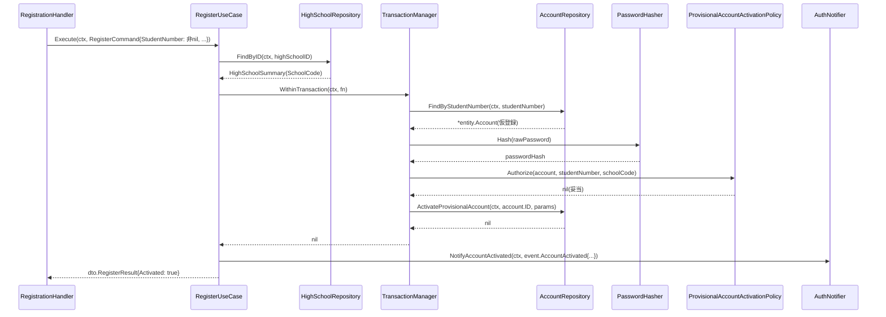

# 認証機能 Go実装仕様書（3. 登録）

---

# 1. 本書の範囲

## 担当するエンドポイント

|Method|Path|Handler|概要|
|-|-|-|-|
|POST|`/api/v1/sign_up`|`RegistrationHandler.SignUp`|ロール別の新規登録。生徒が生徒コードを指定した場合は、仮アカウントの有効化に分岐する|

## 担当するファイル

```
internal/authentication/domain/event/account_activated.go
internal/authentication/domain/repository/grade_repository.go
internal/authentication/domain/repository/high_school_repository.go
internal/authentication/domain/service/provisional_account_activation_policy.go
internal/authentication/domain/service/registration_eligibility_policy.go
internal/authentication/domain/valueobject/signup_role_requirement.go
internal/authentication/application/dto/register_dto.go
internal/authentication/application/usecase/register_usecase.go
internal/authentication/infrastructure/repository/grade_repository.go
internal/authentication/infrastructure/repository/high_school_repository.go
internal/authentication/presentation/handler/registration_handler.go
internal/authentication/presentation/request/registration_request.go
```

実装12ファイル、テスト込みで約20。

## 本書が前提とする文書

- `認証機能_Go実装仕様書_1_基盤.md`: Domain（`Account` Entity・`Email`・`RawPassword`・`StudentNumber`・`AccountRepository`・`UserRoleRepository`・`CredentialVerificationService`・`PasswordHasher`・Domain Error）、共通Infrastructure（`AccountRepositoryImpl`・`UserRoleRepositoryImpl`・`BcryptPasswordHasher`・GORMモデル・`UserResponse`・`MessageResponse`・`routes.go`）、およびTransaction・Validation・Authorization・Error・GORMの実装方針
- 基盤編を実装・マージしたうえで本書の実装に着手する

本書では、基盤編に記載した実装方針を繰り返さない。

---

# 2. Domain層設計（本書の担当）

基盤編に記載したDomainは繰り返さない。本書は本スライスだけが使うDomainを扱う。

## Value Object

### SignUpRoleRequirement（`domain/valueobject/signup_role_requirement.go`）

- struct名: `SignUpRoleRequirement`
- フィールド: `roleName string`（非公開）
- 生成時に検証するルール: ロール名（`student`/`teacher`/`admin`）に応じて高校ID・学年ID・生徒コードが必須かを判定するルールを保持する
- 公開メソッド:
  - `NewSignUpRoleRequirement(roleName string) SignUpRoleRequirement`
  - `(r SignUpRoleRequirement) RequiresHighSchool() bool`
  - `(r SignUpRoleRequirement) RequiresGrade(highSchoolIsCSVManaged bool) bool`
  - `(r SignUpRoleRequirement) RequiresStudentNumber(highSchoolIsCSVManaged bool) bool`

> **②からの補足**: ②「7. Value Object設計」は「studentかつ選択した高校が生徒コード管理対象校（`csv_managed`）の場合、`grade_id`の代わりに`student_number`の入力を必須とする分岐を含む」としている。この判定はロール名だけでなく選択高校の`csv_managed`区分（HighSchoolRepository経由で取得する動的な値）にも依存するため、`RequiresGrade` / `RequiresStudentNumber`は`highSchoolIsCSVManaged bool`を引数に取る形とした。②はメソッドシグネチャそのものを規定していないため、引数設計は実装判断である（推測）。

## Repository Interface

### HighSchoolRepository（`domain/repository/high_school_repository.go`）

master-data Contextが公開する参照手段を利用する（アーキテクチャ規約「5. Context間連携ルール」）。

|メソッド|引数|戻り値|責務|
|-|-|-|-|
|`Exists`|`(ctx context.Context, id uint)`|`(bool, error)`|登録時に指定された`high_school_id`の存在確認|
|`FindByID`|`(ctx context.Context, id uint)`|`(*HighSchoolSummary, error)`|`school_code`・名称の取得（仮アカウント有効化時の学校コード整合確認、`GetCurrentUserUseCase`のレスポンス合成に利用）|

`HighSchoolSummary`のフィールド: `ID uint`, `Name string`, `SchoolCode string`, `CSVManaged bool`

### GradeRepository（`domain/repository/grade_repository.go`）

|メソッド|引数|戻り値|責務|
|-|-|-|-|
|`Exists`|`(ctx context.Context, id uint)`|`(bool, error)`|登録時に指定された`grade_id`の存在確認|
|`FindByID`|`(ctx context.Context, id uint)`|`(*GradeSummary, error)`|`GetCurrentUserUseCase`のレスポンス合成に利用|

`GradeSummary`のフィールド: `ID uint`, `Year int`, `DisplayName string`

## Domain Service

### RegistrationEligibilityPolicy（`domain/service/registration_eligibility_policy.go`）

- struct名: `RegistrationEligibilityPolicy`
- メソッドシグネチャ: `(p RegistrationEligibilityPolicy) Validate(requirement valueobject.SignUpRoleRequirement, highSchoolID, gradeID *uint, studentNumber *valueobject.StudentNumber, highSchoolExists bool, gradeExists bool, highSchoolIsCSVManaged bool) error`
- 責務: 通常登録（生徒コード未指定）時、ロール別要件（学生・教員は高校・学年必須、管理者は不要。生徒コード管理対象校のstudentは`grade_id`の代わりに`student_number`が必須）を満たしているかを判定する

### ProvisionalAccountActivationPolicy（`domain/service/provisional_account_activation_policy.go`）

- struct名: `ProvisionalAccountActivationPolicy`
- 依存: なし
- メソッドシグネチャ: `(p ProvisionalAccountActivationPolicy) Authorize(account *entity.Account, studentNumber valueobject.StudentNumber, highSchoolSchoolCode string) error`
- 責務: 生徒コードに一致する仮アカウントが有効化対象として妥当かを判定する（②「8. Domain Service」）
  - `account`が`nil`（該当する仮アカウントが存在しない）の場合、`ErrProvisionalAccountNotFound`を返す
  - `account.IsProvisional()`が`false`（既に有効化済み）の場合、`ErrProvisionalAccountAlreadyActivated`を返す
  - `studentNumber.MatchesSchoolCode(highSchoolSchoolCode)`が`false`（学校コード不一致）の場合、`ErrStudentNumberSchoolMismatch`を返す
  - 上記いずれにも該当しない場合のみ`nil`を返す

> **②からの補足**: ②「8. Domain Service」はメソッドシグネチャを規定していない。`account *entity.Account`を`nil`許容の引数としたのは、「該当する仮アカウントが見つからない」ケースをUseCase側での事前分岐ではなくPolicy内の判定として一元化するための実装判断である（推測）。

## Domain Event

### AccountActivated（`domain/event/account_activated.go`）

- イベントstruct名: `AccountActivated`
- 保持するフィールド: `AccountID uint`, `Email string`, `ActivatedAt time.Time`
- 発火元: `RegisterUseCase`（生徒コード指定による仮アカウントの有効化が完了した時点。②「18. Domain Event」）

> **②からの補足**: 両イベントの実際のディスパッチ機構は、アーキテクチャ規約「13. 非同期ジョブ実行パターン（JobQueue）」の「処理の分類」表に基づき、パスワードリセットメール送信・有効化完了メール送信はいずれも「ベストエフォートで良い処理」に分類されるため、`jobs`テーブルを経由せず、UseCaseがイベントを構築した後、Infrastructure層のアダプタ（`AuthNotifier`、後述5章）がgoroutineを直接起動して送信する（規約13章「ベストエフォートで良い処理: goroutine起動」の例に準拠）。旧版がイベントバス的な`〇〇EventPublisher`インターフェースを個別に推測していた部分は、規約13章制定に伴い標準パターンへ置き換える。

---

# 3. Application層設計

## DTO（Command / Query）

|struct名|フィールド|区分|
|-|-|-|
|`RegisterCommand`|`Email string`, `Password string`, `PasswordConfirmation string`, `Name string`, `NameKana string`, `RoleName string`, `HighSchoolID *uint`, `GradeID *uint`, `StudentNumber *string`|Command|
|`RegisterResult`|`AccountID uint`, `Email string`, `UserRoleID uint`, `HighSchoolID *uint`, `GradeID *uint`, `Activated bool`（仮アカウント有効化パスで`true`）|出力|

`HighSchoolInfo{ID uint, Name string}`, `GradeInfo{ID uint, Year int, DisplayName string}`, `PersonalInfoView`/`AddressView`はprofile Context側の参照結果をそのまま転記する構造（フィールド詳細はprofile Contextの③文書に委ねる）。

## UseCase

### RegisterUseCase（`application/usecase/register_usecase.go`）

- struct名: `RegisterUseCase`
- コンストラクタが受け取る依存: `UserRoleRepository`, `HighSchoolRepository`, `GradeRepository`, `AccountRepository`, `*service.RegistrationEligibilityPolicy`, `*service.ProvisionalAccountActivationPolicy`, `PasswordHasher`, `TransactionManager`, `AuthNotifier`（Interface、後述8章）
- 公開メソッド: `(u *RegisterUseCase) Execute(ctx context.Context, cmd dto.RegisterCommand) (dto.RegisterResult, error)`
- 処理ステップ（②「13. シーケンス図・処理フロー図」のフローチャートに対応、分岐は`cmd.StudentNumber`の有無）:
  1. `valueobject.NewEmail` / `NewRawPassword`で入力形式を検証し、`RawPassword.Matches`でパスワード確認一致を検証する
  2. `UserRoleRepository.FindByName`でロールの存在確認・ID取得を行う（不正時は`ErrInvalidRole`）
  3. `cmd.StudentNumber`が指定されている場合（仮アカウント有効化パス）:
     1. `valueobject.NewStudentNumber(*cmd.StudentNumber)`で形式検証する
     2. `HighSchoolRepository.FindByID(cmd.HighSchoolID)`で選択高校の`SchoolCode`を取得する
     3. `TransactionManager.WithinTransaction`内で以下を実行する
        1. `AccountRepository.FindByStudentNumber`で仮アカウントを検索する
        2. `PasswordHasher.Hash`で新パスワードをハッシュ化する
        3. `ProvisionalAccountActivationPolicy.Authorize(account, studentNumber, highSchool.SchoolCode)`で有効化可否を判定する
        4. `account.Activate(now)`でドメイン状態を遷移させる
        5. `AccountRepository.ActivateProvisionalAccount(ctx, account.ID, params)`で永続化する
     4. `AuthNotifier.NotifyAccountActivated(ctx, event.AccountActivated{...})`を呼び出す（トランザクション確定後、ベストエフォート送信）
  4. `cmd.StudentNumber`が未指定の場合（通常登録パス）:
     1. `valueobject.NewSignUpRoleRequirement(cmd.RoleName)`でロール別要件を取得する
     2. 必要に応じて`HighSchoolRepository.Exists` / `FindByID`（`csv_managed`判定用）・`GradeRepository.Exists`を呼び出す
     3. `RegistrationEligibilityPolicy.Validate`で登録要件充足を判定する
     4. `PasswordHasher.Hash`でパスワードをハッシュ化する
     5. `TransactionManager.WithinTransaction`内で`AccountRepository.Create`を実行する
  5. `RegisterResult`を返す
- トランザクション境界: 分岐ごとに11章で詳述
- 発生しうるApplication Error: `ErrInvalidRole`, `ErrRegistrationRequirementNotMet`, `ErrPasswordConfirmationMismatch`, `ErrProvisionalAccountNotFound`, `ErrProvisionalAccountAlreadyActivated`, `ErrStudentNumberSchoolMismatch`

---

# 4. Infrastructure層設計（本書の担当）

## Repository実装（本書の担当）

### HighSchoolRepositoryImpl / GradeRepositoryImpl

`high_schools` / `grades`テーブルは master-data Context（共通マスタ参照機能）が正規の所有者であるため（共通マスタ参照機能_Go実装仕様書「15. GORM / DBクエリ設計」参照）、本Contextでは`HighSchoolModel` / `GradeModel`に相当するGORMモデルを独自定義せず、`HighSchoolRepositoryImpl` / `GradeRepositoryImpl`はmaster-data Contextが公開するapplication層関数を呼び出すラッパーとして実装する（アーキテクチャ規約「5. Context間連携ルール」の「相手Contextが公開する参照手段を呼び出す」方針）。

- `HighSchoolRepositoryImpl.Exists(ctx, id)`: `masterdata.ExistsHighSchool(ctx, db, id)`（共通マスタ参照機能_Go実装仕様書「6. Application層設計」）を呼び出し、結果をそのまま返す
- `HighSchoolRepositoryImpl.FindByID(ctx, id)`: `masterdata.FindHighSchoolByID(ctx, db, id)`を呼び出し、戻り値の`*masterdata.HighSchoolDetail`（`ID` / `Name` / `SchoolCode` / `CSVManaged`）を本Contextの`HighSchoolSummary`へ変換する
- `GradeRepositoryImpl.Exists(ctx, id)`: `masterdata.ExistsGrade(ctx, db, id)`を呼び出し、結果をそのまま返す
- `GradeRepositoryImpl.FindByID(ctx, id)`: `masterdata.FindGradeByID(ctx, db, id)`を呼び出し、戻り値の`*masterdata.Grade`（`ID` / `Year` / `DisplayName`）を本Contextの`GradeSummary`へ変換する

> **②からの補足**: HighSchoolRepository/GradeRepositoryの実装先は、本タスクで並行して確定した共通マスタ参照機能_Go実装仕様書が公開する`ExistsHighSchool` / `FindHighSchoolByID` / `ExistsGrade` / `FindGradeByID`（いずれも`internal/master_data/application`直下の関数）とした。これらはauthentication Contextからの実在確認・詳細取得要求（②「3. Bounded Context」「他Contextとの依存関係」）を満たすために共通マスタ参照機能_Go実装仕様書側で定義された関数であり、②の設計判断を変更するものではなく、②が既に想定している依存を具体的な関数シグネチャへ落とし込んだものである（②からの補足）。

---

# 5. Presentation層設計

## Handler

### RegistrationHandler（`presentation/handler/registration_handler.go`）

- struct名: `RegistrationHandler`
- 対応する呼び出し先: `*usecase.RegisterUseCase`
- メソッド一覧:

|メソッド|HTTPメソッド|パス|ロール（固定値としてUseCaseへ渡す）|
|-|-|-|-|
|`SignUpStudent`|POST|`/api/v1/student/signup`|`student`|
|`SignUpTeacher`|POST|`/api/v1/teacher/signup`|`teacher`|
|`SignUpAdmin`|POST|`/api/v1/admin/signup`|`admin`|

- 処理順序（3メソッド共通）: リクエストバインド（`request.SignUpRequest`、ネストされた`user`キー構造を維持）→ Presentation Validation（`binding`タグによる型・必須チェック、`student_number`のハイフン区切り形式チェックを含む。`high_school_id`/`grade_id`/`student_number`のロール別必須判定は本来UseCase内の`RegistrationEligibilityPolicy`が担うため、Handlerでは追加の必須判定を行わない）→ ロール名を固定値として`dto.RegisterCommand`に設定し`RegisterUseCase.Execute`呼び出し → `response.UserResponse`へ変換して返却（Status 201）

> **②からの補足**: `student_number`のフォーマットチェック（②「15. Validation設計」の「バリデーション仕様」表でPresentation層の責務とされている）は、Ginの標準`binding`タグでは「ハイフン区切りの2セグメント」という形式を直接表現できないため、`binding:"omitempty"`による任意項目チェックに加え、Requestの非公開バリデーションメソッド、またはvalidator.v10のカスタムバリデータ登録のいずれかで実装する（②に具体的な実装機構の指定はないため推測）。

## Request DTO

|struct名|フィールドと型|バリデーションタグ／チェック内容|
|-|-|-|
|`SignUpRequest`|`User SignUpUserParams`|`binding:"required"`|
|`SignUpUserParams`|`Email string`, `Password string`, `PasswordConfirmation string`, `Name string`, `NameKana string`, `HighSchoolID *uint`, `GradeID *uint`, `StudentNumber *string`|`Email`: `binding:"required,email"`。`Password`/`PasswordConfirmation`/`Name`/`NameKana`: `binding:"required"`。`HighSchoolID`/`GradeID`/`StudentNumber`: ロール別必須判定はDomain層（`RegistrationEligibilityPolicy`）に委ねるため型チェックのみ。`StudentNumber`は指定時のみハイフン区切り形式を検証する|

`GetCurrentUser`（`GET /api/v1/me`）はパラメータを持たないためRequest DTOを設けない。

Response DTO（`UserResponse`・`MessageResponse`）は基盤編「6. Infrastructure層設計（共通）」の「共通のResponse DTO」に従う。

---

# 6. シーケンス図・処理フロー図

## シーケンス図（RegisterUseCase、仮アカウント有効化パス）



## 処理フロー図（RegisterUseCase）

②「13. シーケンス図・処理フロー図」のフローチャートを、実際に定義したstruct/メソッド名で具体化する。

```mermaid
flowchart TD
    A[Execute呼び出し] --> B{UserRoleRepository.FindByNameでロールは実在するか}
    B -- No --> Z1[ErrInvalidRole]
    B -- Yes --> C{cmd.StudentNumberが指定されているか}
    C -- Yes --> D[valueobject.NewStudentNumberで形式検証]
    D --> E[HighSchoolRepository.FindByIDでSchoolCode取得]
    E --> F[AccountRepository.FindByStudentNumberで仮アカウント検索]
    F --> G[ProvisionalAccountActivationPolicy.Authorize]
    G -- エラー --> Z2["ErrProvisionalAccountNotFound / ErrProvisionalAccountAlreadyActivated / ErrStudentNumberSchoolMismatch"]
    G -- nil --> H["account.Activate(now)"]
    H --> I[AccountRepository.ActivateProvisionalAccountで永続化]
    I --> J[AuthNotifier.NotifyAccountActivated]
    J --> K[RegisterResultを返す]
    C -- No --> L["valueobject.NewSignUpRoleRequirement(cmd.RoleName)"]
    L --> M{ロール要件(高校・学年 or 生徒コード必須)を満たすか}
    M -- No --> Z3[ErrRegistrationRequirementNotMet]
    M -- Yes --> N[AccountRepository.Createで新規作成]
    N --> K
```

---

---

# 7. API仕様

## Errorケース

|Endpoint|条件|Status Code|Error内容|
|-|-|-|-|

---

---

# 8. テストケース設計（本書の担当分）

Domain Test・Repository Testのうち基盤編が担当する分は基盤編に記載する。本書は本スライスのUseCase・Handlerのテストを扱う。
