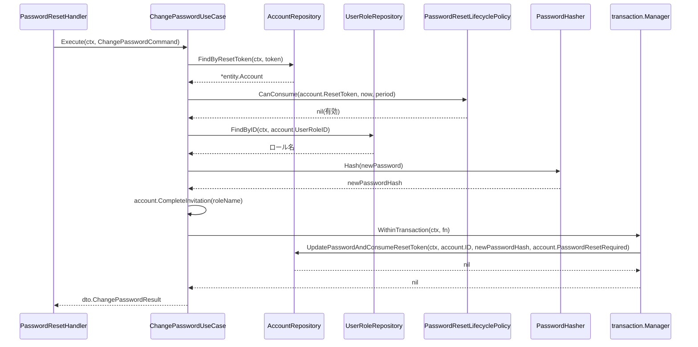

# 認証機能 Go実装仕様書（4. パスワードリセット）

---

# 1. 機能概要

## 本書が担当するエンドポイント

|Method|Path|Handler|概要|
|-|-|-|-|
|POST|`/api/v1/password_resets`|`PasswordResetHandler.RequestReset`|リセットトークンを発行し、メールを送る。退会済みユーザーは対象外とし、結果は常に同一のメッセージを返す|
|PATCH|`/api/v1/password_resets`|`PasswordResetHandler.ChangePassword`|トークンを消費してパスワードを更新する。招待メールのリンクからの初回設定もこの経路|
|GET|`/api/v1/password_resets/verify`|`PasswordResetHandler.VerifyResetToken`|リセットトークンの有効性を確認する|

## 本書の位置づけ

本書は`認証機能_Go実装仕様書_1_基盤.md`（以下「基盤編」）のスライス編である。

基盤編が定めるもの（本書では繰り返さない）:

- Domain層のうち複数のスライスが使うもの（`Account` Entity・`Email`・`RawPassword`・`StudentNumber`・`AccountRepository`・`UserRoleRepository`・`CredentialVerificationService`・`PasswordHasher`・Domain Error）
- 共通Infrastructure（`AccountRepository`・`UserRoleRepository`実装・`BcryptPasswordHasher`・GORMモデル）
- 共通Presentation（`UserResponse`・`MessageResponse`・`routes.go`）
- `context.go`・`dependency.go`、およびTransaction・Validation・Authorization・Error・GORMの実装方針

本書が定めるもの:

- 本スライス固有のDomain（`PasswordResetToken` Entity・`ResetTokenValidityPeriod`・`PasswordResetLifecyclePolicy`・`PasswordResetTokenIssued`イベント）
- 上記3エンドポイントのApplication層（3つのUseCase・DTO）
- `AuthNotifier`・`SecureTokenGenerator`の実装
- 同Presentation層（Handler・Request DTO）
- 同API仕様・テストケース設計

## 採用設計パターン

Domain Model（②「4. 設計パターン」）。基盤編「1. 機能概要」を参照。

基盤編を実装・マージしたうえで本書の実装に着手する。

---

# 2. ディレクトリ構成

基盤編「2. ディレクトリ構成」の機能全体のファイル一覧のうち、本書が担当するものは以下の11である。

```
internal/authentication/domain/entity/password_reset_token.go
internal/authentication/domain/event/password_reset_token_issued.go
internal/authentication/domain/service/password_reset_lifecycle_policy.go
internal/authentication/domain/valueobject/reset_token_validity_period.go
internal/authentication/application/usecase/change_password_usecase.go
internal/authentication/application/usecase/request_password_reset_usecase.go
internal/authentication/application/usecase/verify_reset_token_usecase.go
internal/authentication/infrastructure/mail/auth_notifier.go
internal/authentication/infrastructure/security/secure_token_generator.go
internal/authentication/presentation/handler/password_reset_handler.go
internal/authentication/presentation/request/password_reset_request.go
```

テストが付くのは`PasswordResetToken`・`ResetTokenValidityPeriod`・`PasswordResetLifecyclePolicy`・3つのUseCase・`PasswordResetHandler`の8であり、テスト込みで約19となる。

`presentation/response/`配下に本書専用のファイルを作成しない（`MessageResponse`は基盤編が定義する。`VerifyResetToken`のみ専用のレスポンスを持つため、「9. Presentation層設計」で定義する）。

---

# 3. Domain層設計

基盤編「3. Domain層設計」に記載したDomainは繰り返さない。本書は本スライスだけが使うDomainを扱う。

## Entity

### PasswordResetToken（`domain/entity/password_reset_token.go`）

- struct名: `PasswordResetToken`
- フィールド:

|フィールド|型|意味|
|-|-|-|
|`Token`|`string`|発行されたリセットトークン文字列|
|`IssuedAt`|`time.Time`|トークン発行日時|

- 公開メソッド一覧:

|メソッド|引数|戻り値|責務|
|-|-|-|-|
|`NewPasswordResetToken`|`(token string, issuedAt time.Time) (*PasswordResetToken, error)`|`(*PasswordResetToken, error)`|発行直後のトークンを生成するファクトリ|
|`IsValid`|`(now time.Time, period valueobject.ResetTokenValidityPeriod) bool`|`bool`|現在有効（期限内）かどうかを判定する|

- 不変条件: `Token`は空文字を許容しない。

## Value Object

### ResetTokenValidityPeriod（`domain/valueobject/reset_token_validity_period.go`）

- struct名: `ResetTokenValidityPeriod`
- フィールド: `duration time.Duration`（非公開）
- 生成時に検証するルール: 発行からの有効期間（②により、Devise標準設定を踏襲する前提、具体的な期間は②でも「推測」）
- 公開メソッド: `NewResetTokenValidityPeriod(d time.Duration) ResetTokenValidityPeriod` / `(p ResetTokenValidityPeriod) IsExpired(issuedAt, now time.Time) bool`

> **②からの補足**: 具体的な有効期間の値は②でも未確定（推測）。本書では型・判定メソッドのシグネチャのみを定義し、具体的な時間値は実装時にRails現行設定（`config.reset_password_within`相当）を①側で確認のうえ確定する必要がある（①未提供のため参照不可）。

## Domain Service

### PasswordResetLifecyclePolicy（`domain/service/password_reset_lifecycle_policy.go`）

- struct名: `PasswordResetLifecyclePolicy`
- メソッドシグネチャ: `(p PasswordResetLifecyclePolicy) CanConsume(token *entity.PasswordResetToken, now time.Time, period valueobject.ResetTokenValidityPeriod) error`
- 責務: リセットトークンが現在の状態から見て消費（パスワード更新）可能かを判定する。トークン不一致・未発行・期限切れをそれぞれ区別したDomain Errorを返す

> **②からの補足**: ②「6. Entity設計」の「PasswordResetToken」節は、リセット対象ユーザーの検索において退会済みユーザーを除外することも本Policyの前提条件の一部として言及している。本書では、この退会済み除外は`PasswordResetLifecyclePolicy`の判定メソッド内で行うのではなく、`AccountRepository.FindByEmailExcludingDeleted`によるクエリレベルでのスコープ限定として実装する（基盤編「3. Domain層設計」のRepository Interface参照）。理由は、退会済み判定はAccountの属性（`DeletedAt`）のみで完結し、GORMの論理削除機構（`gorm.DeletedAt`、Gorm規約「0. 本プロジェクトでの採用方針」）によって検索クエリの時点で自然に除外できるため、Policyに判定ロジックを重複させる必要がないという実装判断である（②の記載同士の整合を取るための判断）。

## Domain Event

### PasswordResetTokenIssued（`domain/event/password_reset_token_issued.go`）

- イベントstruct名: `PasswordResetTokenIssued`
- 保持するフィールド: `AccountID uint`, `Email string`, `Token string`, `IssuedAt time.Time`
- 発火元: `RequestPasswordResetUseCase`（対象ユーザーが存在しリセットトークンが発行された時点）

---

# 4. クラス図

基盤編「4. クラス図」を参照。本書は`PasswordResetToken`・`ResetTokenValidityPeriod`・`PasswordResetLifecyclePolicy`・3つのUseCaseを追加するのみである。

---

# 5. 状態遷移図

基盤編「5. 状態遷移図」の「PasswordResetToken」を参照。本書の3つのUseCaseが、`Issued`（`RequestPasswordResetUseCase`）→`Consumed`（`ChangePasswordUseCase`）の遷移、および`Issued`→`Expired`の判定（`VerifyResetTokenUseCase`・`ChangePasswordUseCase`いずれも読み取り）を担う。

---

# 6. Application層設計

## DTO（Command / Query）

|struct名|フィールド|区分|
|-|-|-|
|`RequestPasswordResetCommand`|`Email string`|Command|
|`RequestPasswordResetResult`|`Message string`|出力（常に固定の成功メッセージ）|
|`ChangePasswordCommand`|`ResetPasswordToken string`, `Password string`, `PasswordConfirmation string`|Command|
|`ChangePasswordResult`|`Message string`|出力|
|`VerifyResetTokenQuery`|`ResetPasswordToken string`|Query|
|`VerifyResetTokenResult`|`Valid bool`|出力|

## UseCase

### RequestPasswordResetUseCase（`application/usecase/request_password_reset_usecase.go`）

- struct名: `RequestPasswordResetUseCase`
- コンストラクタが受け取る依存: `AccountRepository`, `ResetTokenGenerator`（Interface、後述）, `transaction.Manager`, `AuthNotifier`
- 公開メソッド: `(u *RequestPasswordResetUseCase) Execute(ctx context.Context, cmd dto.RequestPasswordResetCommand) (dto.RequestPasswordResetResult, error)`
- 処理ステップ:
  1. `valueobject.NewEmail`で入力形式を検証する
  2. `AccountRepository.FindByEmailExcludingDeleted`で対象アカウントを検索する（退会済みは対象外、②「11. Repository設計」）
  3. 存在する場合のみ、`ResetTokenGenerator.Generate`でトークンを生成し、`transaction.Manager.WithinTransaction`内で`AccountRepository.SaveResetToken`を実行する
  4. 存在する場合、`AuthNotifier.NotifyPasswordResetRequested(ctx, event.PasswordResetTokenIssued{...})`を呼び出す
  5. 存在有無に関わらず、常に同一の`RequestPasswordResetResult{Message: "..."}`を返す
- トランザクション境界: ユーザーが存在する場合のみ、トークン発行を1トランザクションとする
- 発生しうるApplication Error: なし（②の方針により、内部的な失敗理由は外部に露出させず常に成功として扱う。Infrastructure Errorのみ5xxとして伝播する）

> **②からの補足**: `ResetTokenGenerator`はセキュリティ用途の乱数生成であり、コーディング規約「23. `crypto/rand`」に従い`crypto/rand`ベースで実装する（`infrastructure/security/secure_token_generator.go`）。他Contextへの依存ではないため`dependency.go`には置かない（コーディング規約「7. インターフェース」の利用側定義）。

### ChangePasswordUseCase（`application/usecase/change_password_usecase.go`）

- struct名: `ChangePasswordUseCase`
- コンストラクタが受け取る依存: `AccountRepository`, `UserRoleRepository`, `*service.PasswordResetLifecyclePolicy`, `PasswordHasher`, `transaction.Manager`
- 公開メソッド: `(u *ChangePasswordUseCase) Execute(ctx context.Context, cmd dto.ChangePasswordCommand) (dto.ChangePasswordResult, error)`
- 処理ステップ:
  1. `valueobject.NewRawPassword`で入力を検証し、確認用パスワードとの一致を検証する
  2. `AccountRepository.FindByResetToken`で対象アカウントを検索する
  3. `PasswordResetLifecyclePolicy.CanConsume`でトークンの有効性を判定する
  4. `UserRoleRepository.FindByID(ctx, account.UserRoleID)`でアカウントのロール名を取得する（ロールが見つからない場合はInfrastructure Error扱い。アカウントのロールIDはマスタに存在する前提）
  5. `PasswordHasher.Hash`で新パスワードをハッシュ化する
  6. `account.CompleteInvitation(roleName)`で招待待ちを解消する（管理者・教員・生徒の`PasswordResetRequired`が偽になる）
  7. `transaction.Manager.WithinTransaction`内で`AccountRepository.UpdatePasswordAndConsumeResetToken(ctx, account.ID, newPasswordHash, account.PasswordResetRequired)`を実行する（パスワードハッシュ更新・トークン消費・招待状態の反映を1操作で行う）
  8. `ChangePasswordResult`を返す
- トランザクション境界: トークン検証からパスワード更新・トークン消費・招待待ちの解消（教員・生徒の場合）までを1トランザクションとする
- 発生しうるApplication Error: `ErrResetTokenNotFound`, `ErrResetTokenExpired`, `ErrResetTokenNotIssued`, `ErrPasswordConfirmationMismatch`

> **②からの補足**: 招待メールのリンクからのパスワード設定は、パスワードリセットと同じトークンの消費であるため、`ChangePasswordUseCase`が招待待ち→招待完了の遷移を担う（②「10. 状態遷移図」「12. UseCase設計」）。招待待ちの解消の対象ロールは、Rails現行の`Auth::ChangePasswordService`に従い管理者・教員・生徒である。既に招待完了のアカウント（招待とは無関係の通常のパスワードリセット）では、`PasswordResetRequired`は偽のまま変化しない。②の「トークン有効性検証からパスワード更新・トークン消費までを1トランザクション」という記載は、招待待ちの解消を含む範囲として実装する。新たなDomain Errorは追加しない。

### VerifyResetTokenUseCase（`application/usecase/verify_reset_token_usecase.go`）

- struct名: `VerifyResetTokenUseCase`
- コンストラクタが受け取る依存: `AccountRepository`, `*service.PasswordResetLifecyclePolicy`
- 公開メソッド: `(u *VerifyResetTokenUseCase) Execute(ctx context.Context, query dto.VerifyResetTokenQuery) (dto.VerifyResetTokenResult, error)`
- 処理ステップ:
  1. `AccountRepository.FindByResetToken`で対象アカウントを検索する
  2. 見つからない場合は`Valid: false`を返す
  3. 見つかった場合、`PasswordResetLifecyclePolicy.CanConsume`相当の読み取り専用判定を行う
  4. `VerifyResetTokenResult`を返す
- トランザクション境界: なし（読み取りのみ）
- 発生しうるApplication Error: なし（不正・期限切れは`Valid: false`として結果に含める）

---

# 7. シーケンス図・処理フロー図

## シーケンス図（ChangePasswordUseCase）



## 処理フロー図

省略する。理由: トークン検証の分岐（`PasswordResetLifecyclePolicy.CanConsume`）はDomain Serviceに閉じており、Handler・UseCaseレベルの条件分岐は単純な直列処理である。

---

# 8. Infrastructure層設計

## 認証技術アダプタ（本書の担当）

|実装対象|呼び出し元|実装方針|
|-|-|-|
|`SecureTokenGenerator`（`infrastructure/security/secure_token_generator.go`）|`RequestPasswordResetUseCase`（`ResetTokenGenerator`）、`LogoutUseCase`（`JTIGenerator`）|コーディング規約「23. `crypto/rand`」に従い`crypto/rand`を用いる|

`SecureTokenGenerator`はセッション編の`LogoutUseCase`も`JTIGenerator`として使う。セッション編を先に実装する場合はそちらで作成してよい。

## 外部連携実装（本書の担当）

### 通知（`infrastructure/mail/auth_notifier.go`）

- struct名: `AuthNotifier`（`application/usecase`層で定義するインターフェースの実装）
- インターフェース定義（`application/usecase`層、利用側で定義。コーディング規約「7. インターフェース」）:

```go
type AuthNotifier interface {
    NotifyPasswordResetRequested(ctx context.Context, evt event.PasswordResetTokenIssued) error
    NotifyAccountActivated(ctx context.Context, evt event.AccountActivated) error
}
```

- 実装方針: アーキテクチャ規約「13. 非同期ジョブ実行パターン（JobQueue）」の「ベストエフォートで良い処理」区分に従い、`jobs`テーブルを経由せず、各メソッド内で`go func() { ... }()`によりgoroutineを直接起動してメール送信基盤を呼び出す。`ctx`はリクエストの生存期間に紐づけず`context.Background()`を使用する（規約13章の例に準拠）。送信失敗はログ出力のみで、呼び出し元（UseCase）へはエラーを伝播させない
- `AuthNotifier`はメール送信という技術的関心事の抽象化であり、他Contextの業務データを参照しないため`dependency.go`には置かない（利用側で定義するインターフェースとして`application/usecase`に置く）

`cache/`・`queue/`は対象外（②に該当要件の記載なし。非同期メール送信は上記のとおり規約13章の「ベストエフォート処理」で扱うため`jobs`テーブル基盤は不要）。

---

# 9. Presentation層設計

## Handler

### PasswordResetHandler（`presentation/handler/password_reset_handler.go`）

- struct名: `PasswordResetHandler`
- 対応する呼び出し先: `*usecase.RequestPasswordResetUseCase`, `*usecase.ChangePasswordUseCase`, `*usecase.VerifyResetTokenUseCase`
- メソッド一覧:

|メソッド|HTTPメソッド|パス|
|-|-|-|
|`RequestReset`|POST|`/api/v1/password/reset/request`|
|`ChangePassword`|PATCH|`/api/v1/password/reset`|
|`VerifyResetToken`|POST|`/api/v1/password/verify`|

- 各メソッド処理順序: リクエストバインド → Presentation Validation（型・必須・メール形式チェック）→ 対応するUseCase呼び出し → `response.MessageResponse`（または`VerifyResetToken`用レスポンス）へ変換して返却

## Request / Response DTO

### Request（`presentation/request/password_reset_request.go`）

|struct名|フィールドと型|バリデーションタグ／チェック内容|
|-|-|-|
|`PasswordResetRequestRequest`|`Email string`|`binding:"required,email"`|
|`ChangePasswordRequest`|`ResetPasswordToken string`, `Password string`, `PasswordConfirmation string`|`binding:"required"`|
|`VerifyResetTokenRequest`|`ResetPasswordToken string`|`binding:"required"`|

### Response（本書専用）

|struct名|フィールドと型|
|-|-|
|`VerifyResetTokenResponse`|`Valid bool`|

`RequestReset`・`ChangePassword`のResponse（`MessageResponse`）は基盤編「9. Presentation層設計」の「Response DTO（共通）」に従う。

## Routing

基盤編「9. Presentation層設計」の`routes.go`に、本書のHandlerに対応する3ルートが含まれる。本書では追加しない。

---

# 10. API仕様

|Method|Path|Handler|Request|Response|Status Code|
|-|-|-|-|-|-|
|POST|/api/v1/password/reset/request|`PasswordResetHandler.RequestReset`|`PasswordResetRequestRequest`|`MessageResponse`|200|
|PATCH|/api/v1/password/reset|`PasswordResetHandler.ChangePassword`|`ChangePasswordRequest`|`MessageResponse`|200|
|POST|/api/v1/password/verify|`PasswordResetHandler.VerifyResetToken`|`VerifyResetTokenRequest`|`VerifyResetTokenResponse`|200|

## Errorケース

|条件|Status Code|Error内容|
|-|-|-|
|リセットトークンに一致するアカウントが存在しない|422|`ErrResetTokenNotFound`|
|リセットトークンが有効期限切れ|422|`ErrResetTokenExpired`|
|リセットトークンが発行されていない状態での消費操作|422|`ErrResetTokenNotIssued`|
|パスワードと確認用パスワードが一致しない|422|`ErrPasswordConfirmationMismatch`|
|`RequestReset`の対象ユーザー不存在|200|エラーにしない。常に固定の成功メッセージを返す（②「17. Error設計」）|
|`VerifyResetToken`の不正・期限切れ|200|エラーにしない。`Valid: false`を返す|
|Request DTOバリデーションエラー|422|Presentation Validation|

---

# 11. Transaction実装方針

基盤編「11. Transaction実装方針」を参照。本書のUseCaseは以下のとおりである。

|UseCase|終了箇所|
|-|-|
|`RequestPasswordResetUseCase`|`AccountRepository.SaveResetToken`完了時点でCommit（対象ユーザーが存在する場合のみトランザクションを使用）|
|`ChangePasswordUseCase`|`AccountRepository.UpdatePasswordAndConsumeResetToken`完了時点でCommit、トークン検証失敗時はトランザクションを開始しない|
|`VerifyResetTokenUseCase`|トランザクションを使用しない（読み取りのみ）|

`AuthNotifier`の呼び出しはCommit後に行い、トランザクションのスコープ外とする（②「14. Transaction設計」）。

---

# 12. Validation実装方針

基盤編「12. Validation実装方針」の各Requestの行を参照。本書に固有の業務ルール検証は以下のとおりである。

- `ChangePasswordUseCase` / `VerifyResetTokenUseCase`: `PasswordResetLifecyclePolicy.CanConsume`によるトークン有効性判定
- `ChangePasswordUseCase`: `RawPassword.Matches`によるパスワード確認一致判定

---

# 13. Authorization実装方針

基盤編「13. Authorization実装方針」を参照。パスワードリセット系エンドポイントは認証チェック対象外（Middlewareを適用しない）であり、各UseCaseは認証済みユーザーの有無に依存しない業務ルールの検証のみを行う。

---

# 14. Error実装方針

基盤編「14. Error実装方針」のエラー対応表を参照。本書固有の追加はない（上記「10. API仕様」のErrorケースは基盤編の表の抜粋である）。

---

# 15. GORM / DBクエリ設計

基盤編「15. GORM / DBクエリ設計」を参照。本書固有のGORMモデルはない。

---

# 16. テストケース設計（本書の担当分）

基盤編が担当するDomain Test・Repository Testは基盤編を参照。本書は本スライス固有のDomain・UseCase・Handlerのテストを扱う。

## Domain Test

|対象|テストケース|
|-|-|
|`PasswordResetToken.IsValid`|発行直後は有効／有効期間経過後は無効と判定する|
|`ResetTokenValidityPeriod.IsExpired`|境界値（有効期間ちょうど）での判定|
|`PasswordResetLifecyclePolicy.CanConsume`|未発行・期限切れ・有効の3状態での判定|

## UseCase Test

|対象|テストケース|
|-|-|
|`RequestPasswordResetUseCase`|対象ユーザーが存在する場合にトークンが発行され通知されること／存在しない場合も同一の成功メッセージが返ること（列挙防止）／退会済みユーザーが対象から除外されること|
|`ChangePasswordUseCase`|正しいトークンでパスワードが更新されること／期限切れ・未発行・不一致トークンでそれぞれ区別されたエラーになること／教員・生徒で招待待ちが解消されること／管理者で招待待ちが変化しないこと|
|`VerifyResetTokenUseCase`|有効なトークンで`Valid: true`／不正・期限切れで`Valid: false`になること|

## Handler Test

|対象|テストケース|
|-|-|
|`PasswordResetHandler.RequestReset`|正常系で200（常に同一メッセージ）|
|`PasswordResetHandler.ChangePassword`|正常系で200／トークン不正で422|
|`PasswordResetHandler.VerifyResetToken`|正常系で200と`Valid`の値|

## Integration Test

|対象|テストケース|
|-|-|
|`POST /api/v1/password/reset/request` → `PATCH /api/v1/password/reset`|一連の流れでパスワードリセットが完了し、新しいパスワードでログインできること|

---

# 17. ②からの補足事項

②に明記がなく、実装のために本書で補った内容である。基盤編「17. ②からの補足事項」に記載した内容に加え、本書固有のものを以下に示す。

|判断した内容|判断理由|推測か|
|-|-|-|
|`ResetTokenValidityPeriod`の具体的な有効期間の値を確定しなかった|②自身が「推測」と明記し、Devise標準設定を踏襲する前提のみで具体的な数値がない。①未提供のため確定できない|①未提供のため参照不可（②の推測を維持）|
|`AuthNotifier`を`dependency.go`に置かず、`application/usecase`層で利用側定義した|メール送信という技術的関心事の抽象化であり、他Contextの業務データを参照する依存ではないため（コーディング規約「7. インターフェース」）|推測ではない|
|`VerifyResetTokenResponse`を本書専用のResponse DTOとして新設した|`VerifyResetToken`のみ`Valid: bool`という固有の形を返し、基盤編の`UserResponse`・`MessageResponse`のいずれにも当たらないため|推測ではない（②「19. API仕様」の構造をそのまま反映）|

上記以外の設計判断は基盤編の記載をそのまま踏襲する。
